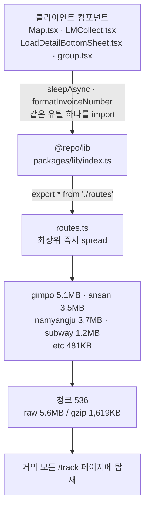

# Vercel Fast Data Transfer 비용 추적 : 배럴 export가 번들에 남긴 13.5MB

비용 최적화는 어떤 극적인 계기로 시작되는 일이 아니다. 인프라 청구서를 열어보고 눈에 걸리는 항목을 확인하는 건 그냥 업무의 일환이다. 이번에 걸린 항목은 주문추적 플랫폼의 Vercel **Fast Data Transfer**였다.

트래픽이 늘면 전송량이 늘고, 전송량이 늘면 돈이 나간다. 여기까지는 이상할 게 없다. 다만 SMS로 받은 링크를 눌러 배송 상태를 한 번 확인하고 떠나는 서비스가 쓰는 금액치고는 감이 잘 오지 않았다. 감이 오지 않으면 재는 수밖에 없다. 이 글은 그 측정에서 출발해 공유 패키지의 배럴 export까지 거슬러 올라간 기록이다.

#### 무엇에 돈이 나가는지부터

측정 기준일은 2026년 8월 4일, 하루치다.

| 항목                      | 값          | 비중  |
| ------------------------- | ----------- | ----- |
| Fast Data Transfer 청구액 | $15.26      | —     |
| Outgoing                  | 95.45 GB    | 97.5% |
| Incoming                  | 2.45 GB     | 2.5%  |
| **합계**                  | **97.9 GB** | 100%  |

[Fast Data Transfer](https://vercel.com/docs/manage-cdn-usage)는 Vercel CDN과 방문자 기기 사이를 오간 데이터 전송량이다. HTML, JS 번들, 이미지, 정적 파일이 전부 여기 집계된다.

[!note] 측정 범위가 생각보다 넓다. 응답 body만이 아니라 **헤더 전체 + 전체 URL + 압축 후 크기**까지 포함하고, 응답(Outgoing)과 요청(Incoming) 양방향을 모두 계산한다.

요금은 이렇게 붙는다.

| 구분             | 포함량  | 초과분               |
| ---------------- | ------- | -------------------- |
| 전체 리전 범위   | 첫 1 TB | 1 GB당 $0.15 ~ $0.35 |
| **Seoul (icn1)** | 첫 1 TB | **1 GB당 $0.35**     |

[리전 요금표](https://vercel.com/docs/pricing/regional-pricing)에서 [icn1](https://vercel.com/docs/pricing/regional-pricing/icn1)은 가장 비싼 구간이다. 요금은 요청이 도달한 CDN 리전 기준으로 매겨지니, 국내 트래픽 위주 서비스는 $0.35가 그대로 적용된다.

여기서 착각하기 쉬운 게 포함량 1TB다. 이건 프로젝트별 무료 한도가 아니라 **팀 단위 합산**이다. Usage 페이지는 기본적으로 계정 내 모든 프로젝트를 집계하고, allotment 표시도 청구 주기와 팀 기준이다. Project 뷰는 최적화 대상을 찾기 위한 필터일 뿐 별도 무료 한도를 주지 않는다. 내부 백오피스와 주문접수 플랫폼이 쓴 양도 같은 1TB에서 빠져나간다. ([Manage and optimize usage](https://vercel.com/docs/pricing/manage-and-optimize-usage))

이름이 비슷한 형제 항목들과도 구분해야 한다. 나는 처음에 이 셋을 몇 번 헷갈렸다.

| 항목                                | 측정 구간              | icn1 요금                         |
| ----------------------------------- | ---------------------- | --------------------------------- |
| Fast Data Transfer                  | CDN ↔ 방문자           | 1TB 포함, 이후 $0.35/GB           |
| Fast Origin Transfer                | CDN ↔ Vercel Functions | 포함량 없음, $0.24/GB             |
| Edge Requests (문서상 CDN Requests) | CDN이 처리한 요청 건수 | 1,000만 건 포함, 이후 $2.60/100만 |

Fast Origin Transfer는 Functions뿐 아니라 Middleware, Blob, ISR을 경유하는 Data Cache에서도 발생한다. Middleware가 걸려 있으면 한 번의 Function 요청이 두 번 집계될 수 있어서 matcher로 실행 범위를 좁히는 게 정석이다.

한 가지 더. 서드파티 블로그에 "GB당 $0.01"이라는 수치가 돌아다니는데 공식 문서와 맞지 않는다. ~~그 숫자를 믿고 예산을 세웠다면 35배쯤 낙관적인 계획이 나왔을 것이다.~~ 위 표가 공식 기준이다.

#### 단위 경제로 환산하기

같은 날 GA 지표를 붙여 나눠봤다.

| 지표             | 값        |
| ---------------- | --------- |
| page_view 이벤트 | 147,935회 |
| 세션             | 34,179건  |
| 사용자           | 46,312명  |

| 기준             | 계산              | 값             |
| ---------------- | ----------------- | -------------- |
| page_view 1건당  | 95.45GB ÷ 147,935 | 약 645 KB      |
| **세션 1건당**   | 95.45GB ÷ 34,179  | **약 2.79 MB** |
| 세션당 page_view | 147,935 ÷ 34,179  | 4.33건         |

주문추적 플랫폼은 SMS 링크로 진입하는 일회성 조회가 대부분이다. 재방문이 거의 없으니 대다수 세션이 콜드 캐시 최초 로드다. 그래서 page_view당 645KB보다 **세션당 2.79MB**가 실질 지표에 가깝다.

모바일 배송조회 페이지 하나가 2.79MB를 쓰는 게 맞는 수치일까? 지도도 대시보드도 아니고 운송장 번호와 배송 상태를 보여주는 화면이다. 이쯤에서 청구서를 덮고 번들을 열었다.

#### 번들을 열어봤다

`next build` 출력부터 봤다. 주문추적 플랫폼의 `/track` 라우트 First Load JS가 1.95MB였다. `/track`은 지도를 쓰지 않는다.

[@next/bundle-analyzer](https://www.npmjs.com/package/@next/bundle-analyzer)를 붙여 트리맵을 열어보니 청크 하나가 압도적으로 컸다. raw 5.6MB, gzip 1,619KB. 안을 열어보니 이런 게 끝없이 이어졌다.

```
[126.7489597,37.3282136],[126.7488725,37.3279038],[126.7488215,37.3276971], ...
[127.0910359679,37.1650699287],[127.0910581867,37.1651199234], ...
```

소수점 10자리까지 찍힌 한국 행정구역 GeoJSON 좌표다. 배송조회 화면이 이걸 gzip 1.6MB어치 들고 내려가고 있었다.

#### 원인 : 배럴과 최상위 즉시 spread

공유 패키지의 배럴이 시작점이었다.

```tsx
// packages/lib/index.ts
export * from "./clientConfigs";
export * from "./hooks";
export * from "./utils";
export * from "./regex";
export * from "./routes"; // ← 문제 지점
```

그리고 재export되는 `routes.ts`는 이렇게 생겼다.

```tsx
// packages/lib/routes.ts
import gimpoRoutes from "./routes/gimpo.json"; // 5.1 MB
import ansanRoutes from "./routes/ansan.json"; // 3.5 MB
import namyangjuRoutes from "./routes/namyangju.json"; // 3.7 MB
import subwayRoutes from "./routes/subway.json"; // 1.2 MB
import etcRoutes from "./routes/etc.json"; // 481 KB

// 모듈 최상위에서 즉시 배열을 조립한다 → tree-shaking 원천 불가
export const routes: RouteData[] = [
  ...(gimpoRoutes as RouteData[]),
  ...(ansanRoutes as RouteData[]),
  ...(namyangjuRoutes as RouteData[]),
  ...(subwayRoutes as RouteData[]),
  ...(etcRoutes as RouteData[]),
];
```

합쳐서 13.5MB다. 그리고 이건 지워질 수가 없다.

[tree-shaking](https://webpack.js.org/guides/tree-shaking/)은 참조되지 않는 export를 걷어내는 최적화지, 최상위에서 실행되는 코드를 없애주는 기능이 아니다. `routes`는 모듈 평가 시점에 JSON 5개를 spread해 새 배열을 **즉시 만든다.** 아무도 `routes`를 읽지 않더라도 그 배열은 만들어져야 하고, 만들려면 JSON 5개가 번들에 들어 있어야 한다. 결과적으로 이 패키지에서 **무엇을 import하든** 13.5MB가 함께 끌려온다.

오염 경로는 이렇게 그려진다.



`sleepAsync` 하나 쓰려고 배럴을 거치면 지리정보 13.5MB가 따라붙는다. 그리고 그 배럴을 거치는 클라이언트 컴포넌트가 여기저기 있으니, 지도와 무관한 페이지까지 전부 오염된다.

그럼 이 데이터를 실제로 쓰는 곳은 어디인가. 두 곳이었다.

| 위치                                                    | 사용 심볼                           | 실행 환경         |
| ------------------------------------------------------- | ----------------------------------- | ----------------- |
| 주문추적 플랫폼 `pages/api/routes/.../[toStationId].ts` | `getRouteCoordinates`               | 서버 (API 라우트) |
| 내부 백오피스 `pages/routes/index.tsx`                  | `getRoutePairs`, `getRouteStations` | 클라이언트        |

서버에서 한 번, 내부 백오피스에서 한 번. 주문추적 플랫폼의 클라이언트 번들에는 애초에 들어갈 이유가 없는 데이터였다.

#### 수정 : 4개 파일, +8 / −4

원인이 배럴이었으니 고칠 것도 배럴이다.

| 파일                                       | 변경                                               |
| ------------------------------------------ | -------------------------------------------------- |
| `packages/lib/index.ts`                    | `export * from "./routes"` 제거 + 재추가 방지 주석 |
| 주문추적 플랫폼 API 라우트                 | `@repo/lib` → `@repo/lib/routes` 직접 import       |
| 내부 백오피스 `pages/routes/index.tsx`     | 동일                                               |
| 주문추적 플랫폼 `components/track/Map.tsx` | 값 import → `import type` (위생 목적)              |

배럴에서 재export를 빼고, 실제로 쓰는 두 곳만 서브패스로 직접 import하게 했다. 그게 전부다.

[!note] `Map.tsx`의 `import type` 변경은 **단독으로는 효과가 0이었다.** 먼저 이것만 고쳐보고 빌드했는데 First Load JS가 1.95MB에서 꿈쩍하지 않았다.[break]클라이언트 컴포넌트가 API 라우트 파일에서 타입을 값 import 문법으로 가져오던 문제라 위생상 고치는 게 맞지만, 이번 비용의 원인은 아니었다. 같은 패턴이 7곳 더 남아 있다.

#### 결과

빌드 출력을 다시 찍었다.

| 라우트                   | Before  | After      | 감소 |
| ------------------------ | ------- | ---------- | ---- |
| `/track`                 | 1.95 MB | **309 kB** | −84% |
| `/track/[invoiceNumber]` | 1.97 MB | **334 kB** | −83% |
| `.../submit-return`      | 1.98 MB | 344 kB     | −83% |
| `.../report/delivery`    | 1.97 MB | 336 kB     | −83% |
| `.../group`              | 1.97 MB | 336 kB     | −83% |

5.6MB GeoJSON 청크는 사라졌고 최대 청크는 raw 320KB로 내려갔다. 콜드 로드당 gzip 약 **1.64MB** 절감이다. 내부 백오피스도 `✓ Compiled successfully`가 떴다. import 경로만 바꿨으니 당연하지만 확인은 해야 한다.

[!note] Next.js가 빌드 출력에 찍는 First Load JS는 **gzip 기준**이다. 수정 전 청크 내역(170 + 1,619 + 105 + 24 + 10 + 1 ≈ 1,929kB)이 표기값 1.95MB와 맞아떨어져서 확인됐다.

번들을 들여다보는 김에 하나 더 걸렸다. 마커 아이콘 `deli.svg`(raw 226KB / gzip 93KB) 안에 2732×2048, 약 5.6MP PNG가 base64로 박혀 있었다. 화면에 그려지는 크기는 36×36이다. 필요한 픽셀의 4천 배가 넘는 해상도를 들고 다닌 셈이다. ~~디자인 툴에서 내보낸 파일을 아무도 열어보지 않으면 이런 일이 생긴다.~~

`next.config.js`의 `@svgr/webpack` 규칙 때문에 이 파일은 컴포넌트로 import되어 JS 번들에 인라인되고 있었다. svgr 경로에서 빼고 66×66 PNG(2.9KB) 정적 파일 참조로 교체했다. 콜드 로드당 gzip 약 90KB가 더 줄어 `/track`은 220kB 부근이 됐다.

#### 비용으로 되돌리기

번들이 줄어든 건 빌드 출력으로 확인됐다. 남은 건 이게 청구서에서 얼마인가다. 여기서부터 계산이 몇 번 어긋났다.

먼저 한계 단가를 확정해야 했다. 8월 4일 하루치를 그대로 나누면 GB당 $0.156이 나오는데, 이 값을 그대로 쓰면 안 된다. 그날이 무료 1TB 경계에 걸쳐 일부가 무료로 처리된, 희석된 단가였다. 7월 한 달 실측으로 보면 다르다.

| 항목                 | 값                                                |
| -------------------- | ------------------------------------------------- |
| Data Transfer 청구액 | $1,495                                            |
| Outgoing             | 5.04 TB (약 5,040 GB)                             |
| Incoming             | 79 GB                                             |
| **합계**             | **약 5,119 GB**                                   |
| 청구 주기 시작일     | 매월 25일 (25일에 $0로 급감 → 무료 1TB 리셋 관측) |

- Outgoing의 **99.1%가 icn1**이다. 저렴한 리전으로 분산되고 있다는 가정은 기각됐다.
- 무료 1TB를 제외한 과금분 약 4,040GB로 $1,495를 역산하면 GB당 약 **$0.37**. 공식 icn1 단가 $0.35와 사실상 일치한다.

팀은 무료 1TB를 주기 초 6일쯤이면 소진한다. 주문추적 플랫폼 하나가 5TB를 쓰니 아낀 GB는 전부 과금 구간에 있다. 절감액이 무료분에 희석되지 않는다는 뜻이다.

그다음 프로덕션 실측에서 한 번 더 걸렸다. Vercel Usage 대시보드의 일별 데이터는 **Pacific Time 기준**으로 하루를 자른다. KST와는 16시간 차이다.

- Vercel의 "하루" = PT 00:00~23:59 = **KST 16:00 ~ 익일 15:59**
- [`vercel usage` CLI](https://vercel.com/docs/cli/usage)의 `--from`/`--to`도 "midnight in Los Angeles time" 기준이다
- 대시보드 데이터는 최대 1시간 지연되어 표시된다

한국에서 오전에 대시보드를 열고 "오늘"을 보면, 전날 오후 4시부터 쌓인 절반도 안 되는 값을 보고 있는 것이다. 나는 8월 6일 데이터를 그렇게 읽었다.

| 지표                    | 07/21 (수정 전) | 08/06 (수정 후) | 변화     |
| ----------------------- | --------------- | --------------- | -------- |
| Fast Data Transfer 용량 | 138.37 GB       | 16.47 GB        | −88%     |
| Fast Data Transfer 비용 | $51.29          | $3.24           | −94%     |
| page_view               | 200,711         | 145,414         | −28%     |
| view당 전송량           | 689 KB          | 113 KB          | **−84%** |

view당 689KB → 113KB, 84% 감소는 번들 실측과 방향이 맞는다. 다만 이 하루는 PT 기준 약 8시간치라 그대로 월로 환산할 수 없다. 게다가 그 8시간이 KST 16:00~01:00, 트래픽이 몰리는 구간이라 시간 비례로 3배 하는 것도 과대 추정이다.

절감액을 굳이 적으면 이 정도 범위가 된다.

| 관점                               | 계산                  | 월 절감액 |
| ---------------------------------- | --------------------- | --------- |
| 8/6 실측 감소율 그대로             | 5,119GB × 88% × $0.35 | 약 $1,577 |
| 트래픽 보정 (view 28% 적음)        | 5,119GB × 84% × $0.35 | 약 $1,505 |
| 보수적 (일별 변동 감안)            | $1,495 × 80%          | 약 $1,196 |
| 초기 추정 (콜드 로드 1회 기준 57%) | —                     | 약 $1,000 |

위쪽 두 줄은 불완전한 하루에서 나온 값이라 상한으로 보는 게 맞다. 실제로는 초기 추정인 **월 $1,000** 근처를 하한으로 두고 그 위 어딘가라고 말하는 정도가 지금 할 수 있는 전부다. 찝찝하지만 PT 기준으로 하루가 채워지기를 기다리는 중이다.

수정 전후 감소율이 예상보다 컸던 이유는 짚어둘 만하다. `_next/static`은 immutable 캐시라 배포마다 해시가 갱신된다. 5.6MB 청크가 빠지면서 배포당 캐시 bust 페널티가 1.6MB에서 200KB 수준으로 내려갔고, 그만큼 CDN HIT율이 올랐다. 뒤집어 말하면 **배포가 잦은 서비스일수록 콜드 로드가 늘어나고, 번들을 줄인 효과도 커진다.**

#### 남은 것

미해결 항목이 있다. 단위 경제 계산에 쓴 GA 지표가 사용자 46,312명, 세션 34,179건이다. 동일 기간·동일 스코프라면 GA4에서는 보통 세션이 사용자보다 많거나 같다. 두 지표의 기간이나 스코프가 어긋나 있다는 뜻이고, 그렇다면 세션당 2.79MB도 그만큼 흔들린다. 어디서 어긋났는지까지는 확인하지 못했다.

클라이언트 컴포넌트가 `pages/api` 파일에서 값 import 문법으로 타입을 가져오는 곳이 7군데 남아 있다. 지금은 번들에 영향이 없지만, 그 API 파일에 무거운 의존성이 붙는 순간 같은 일이 반복된다.

`packages/lib/index.ts`에는 재추가를 막는 주석을 남겼다. 다만 주석은 사람이 읽어야 작동하니 신뢰할 만한 장치는 아니다. 번들 크기 회귀는 CI에서 잡는 쪽이 맞고 First Load JS 임계값 체크 정도가 후보인데, 아직 붙이지는 않았다.

#### 번들 크기를 어디서 보고 있었나

이번 일에서 새로 배운 기술은 딱히 없다. 배럴 export가 tree-shaking을 막는다는 것도, 최상위에서 평가되는 코드는 지워지지 않는다는 것도 이미 아는 이야기였다. 그런데 나는 그걸 계속 **성능 문제**로만 분류해두고 있었다. 번들이 크면 LCP가 밀리고 TTI가 늦어진다, 그러니 줄이는 게 좋다. 그 정도의 우선순위였다.

이번에는 같은 사실이 청구서로 왔다. 같은 1.6MB인데 성능 지표로 볼 때와 GB당 $0.35로 볼 때 체감이 달랐다. ~~숫자에 달러 기호가 붙으면 갑자기 급해진다.~~ 어느 쪽이 더 옳은 관점이라고 말하려는 건 아니다. 다만 번들 크기를 볼 창이 하나 더 있다는 걸 이번에는 청구서 쪽에서 확인했다.

최종 절감액은 아직 확정하지 못했고, GA 지표 정합성도 남아 있다. 그래도 13.5MB의 지리정보가 배송조회 화면까지 따라오고 있었다는 사실 자체는, 청구서를 열어 나눠보지 않았으면 몰랐을 일이다.
