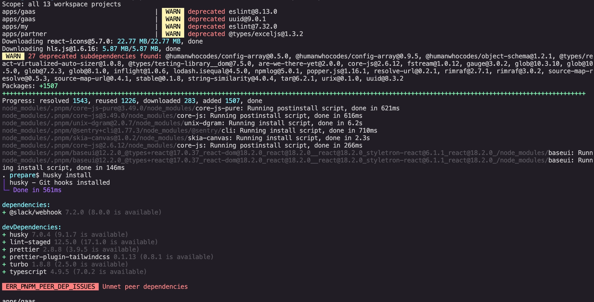
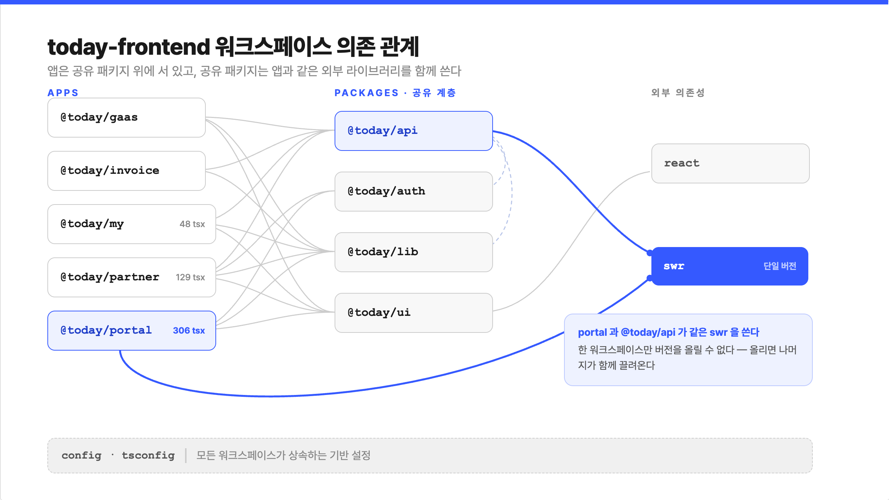
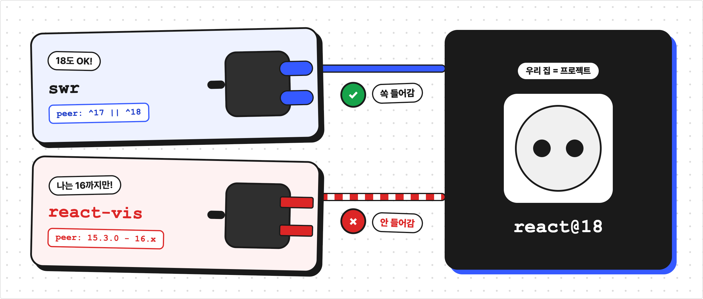
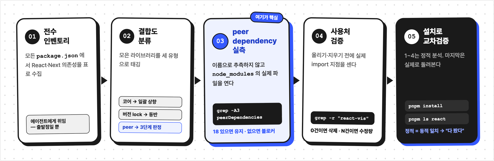
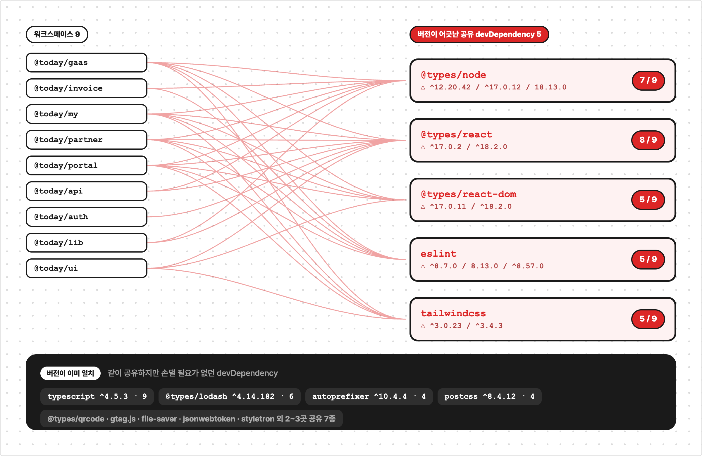

# React 18 마이그레이션 1/4 계획편: react만 18로 올리면 끝인 줄 알았습니다

[!note] 본 게시글은 VTOV 기술 블로그에 공식 기고된 글입니다. [이 URL](https://career.vtov.kr/contents/tech/react-18-migration-1-plan)에서 원문을 확인할 수 있습니다.

안녕하세요. 물류 플랫폼 프론트엔드를 만들고 있는 개발자, 이재원입니다. 최근에 앱 3개와 공유 패키지 5개가 들어 있는 모노레포를 **React 17 → 18.2**, **Next.js 12 → 14**로 올리는 일을 맡았습니다. 처음부터 끝까지 AI 에이전트(Claude Code)와 함께 진행했는데요. 그래서 이 시리즈는 "React 18로 올리는 법"인 동시에 "에이전트와 어떻게 일을 나눴나"에 대한 기록이기도 합니다.

그런데 1편에는 코드가 거의 안 나옵니다. `<Link>`를 어떻게 바꿨는지 같은 이야기는 뒤로 미루고, 여기서는 **키보드에 손을 올리기 전에 한 일**을 다뤄요. 대체 뭘, 왜 손대야 하는지 그 목록을 어떻게 뽑았는가 하는 이야기입니다.

주니어 시절의 저였다면 이 단계를 통째로 건너뛰었을 거예요. `package.json` 열어서 `"react": "18.2.0"` 적고 설치하면 되는 거 아냐? 저도 그렇게 생각했다가 크게 데였습니다. 그 이야기부터 해볼게요.

## **`react`만 올리면 되는 줄 알았습니다**

처음 계획은 세 줄이었어요. React를 올리는 거니까 `react`, `react-dom`, 그리고 같이 올리기로 한 `next`. 딱 세 줄만 바꾸면 될 것 같았습니다.

그런데 버전을 바꾸고 `pnpm install`을 돌리자, 경고가 우수수 쏟아지더니 결국 `ERR_PNPM_PEER_DEP_ISSUES`로 설치가 멈춰 섰어요. "이 버전끼리는 못 논다"는 unmet peer가 워크스페이스마다 나왔고, 린트도 "이 ESLint 버전으론 안 돼"라고 했습니다. 세 줄인 줄 알았던 변경이, 알고 보니 열 개가 넘는 라이브러리가 얽힌 그물이었던 거죠.



마이그레이션의 진짜 난이도는 여기 있었습니다. 어려운 건 React 18의 새 문법이 아니라, **"React 하나를 건드리면 무엇까지 같이 움직여야 하는가를 근거 있게 알아내는 일**이었어요. 그 답을 구하려면 먼저 세 가지 개념이 필요합니다. 주니어 분들을 위해 세 부분만 짚고 갈게요.

## **잠깐, 세 가지 개념부터**

### **1) 모노레포 — 여러 앱이 하나의 의존성 트리를 공유한다**

**모노레포(monorepo)는 여러 개의 앱과 패키지를 하나의 저장소에서 함께 관리하는 방식**이에요. 저희 저장소도 [Turborepo](https://turborepo.org/) 기반 모노레포라, 아래처럼 앱 여러 개와 공유 패키지가 한곳에 들어 있습니다.

```xml
today-frontend
├── apps/
│   ├── my/        고객 배송 추적    (~48 tsx)
│   ├── partner/   파트너 주문 관리  (~129 tsx)
│   └── portal/    운영팀 관리자 포털 (~306 tsx)
└── packages/
├── ui/  auth/  api/  lib/  config/   ← 앱들이 공유하는 하부 계층
```

중요한 성질이 하나 있어요. `apps/portal`도 `swr`을 쓰고, 공유 패키지 `@today/api`도 `swr`을 씁니다. **여러 워크스페이스가 같은 라이브러리를 나눠 쓰는** 구조죠. 이게 왜 골치 아픈지는 조금 뒤에 다시 나옵니다.



*앱들이 같은 공유 패키지에 함께 기대고 있어서, 그 아래 깔린 `react`·`swr` 버전을 한 곳만 따로 바꿀 수 없습니다.*

### **2) `node_modules`와 dependency vs devDependency**

**`node_modules`는 `pnpm install`이 실제 라이브러리 파일들을 내려받아 쌓아두는 폴더입니다.** 여기서 중요한 사실 하나 — 그렇게 깔린 패키지도 **각자 자기만의 `package.json`을 갖고 있습니다.** 내 프로젝트의 `package.json`이 "내가 원하는 버전"이라면, `node_modules/react-vis/package.json`은 "그 라이브러리가 실제로 요구하는 것"을 담고 있어요. 나중에 보겠지만, 판단의 근거는 늘 후자에 있었습니다.

의존성에는 종류가 있습니다.

- `dependencies` — 앱이 실행될 때 필요한 것. 번들에 실려 브라우저까지 갑니다. (`react`, `swr`, `recoil`)
- `devDependencies` — 개발·빌드할 때만 필요한 것. 번들엔 안 들어갑니다. (`@types/react`, `eslint`, `next-transpile-modules`)

"그럼 devDependency는 마이그레이션에서 신경 안 써도 되겠네?" 저도 그렇게 넘길 뻔했는데, 아니었습니다. `@types/react`나 `eslint-config-next` 같은 devDependency도 프레임워크 버전에 단단히 묶여 있거든요. (뒤에서 실제로 이것들이 어떻게 딸려 올라왔는지 보여드릴게요.)

### **3) peer dependency — "나는 이 React랑만 놀아요"**

가장 자주 발목을 잡는 게 **peer dependency**예요. 한 줄로 말하면, **라이브러리가 "나랑 같이 쓰려면 프로젝트에 이 버전대의 React가 깔려 있어야 해"라고 내거는 조건**입니다.

왜 이런 게 필요하냐면, React 위에서 도는 라이브러리는 React를 자기가 직접 설치하지 않고 프로젝트가 가진 걸 빌려 쓰기 때문이에요. 그래서 "나를 쓰는 프로젝트야, 네가 가진 React를 쓸게. 단, 이 버전 범위여야 해"라고 미리 선언해 둡니다.

```xml
*// node_modules/react-vis/package.json*
"peerDependencies": {
	"react": "15.3.0 - 16.x"    // "나는 React 16까지만 지원해요"
}
```

라이브러리를 세입자, React를 그 집 콘센트 규격이라고 해볼게요. 세입자가 "나는 220V만 돼요"라고 써 붙였는데 집을 110V로 바꾸면? 세입자가 나가든가(교체), 110V를 쓰는 새 세입자를 들여야 합니다. peer 범위에 내가 올리려는 React가 없으면 그 라이브러리는 그대로 둘 수 없다 — 이게 범위 판단의 뼈대입니다.



## **그래서 프레임워크는 혼자 못 움직인다**

이제 처음 질문으로 돌아갈게요. 왜 세 줄이 열 개짜리 그물이 됐을까요? React/Next는 세 가지 방식으로 주변 라이브러리와 엮여 있기 때문입니다.

| 결합 유형 | 무슨 뜻인가 | 사례 |
| --- | --- | --- |
| **peer dependency 결합** | 특정 React 메이저만 peer로 허용. 안 맞으면 설치부터 충돌 | `react-vis` (React 16까지) |
| **프레임워크 버전 lock** | 툴이 Next/ESLint 특정 라인에 종속. 프레임워크를 올리면 툴도 같이 | `eslint-config-next@14` → `eslint@8` 요구 |
| **동작 정합성 결합** | peer는 통과해도, React 18 렌더링 모델과 맞추려면 대응 버전이 필요 | `swr@2` (React 18의 `useSyncExternalStore` 기반) |

세 번째가 특히 까다로웠어요. `swr@1`도 React 18에서 설치는 됩니다. 하지만 React 18의 동시성 렌더링과 정합을 맞추려면 외부 스토어 구독 API를 쓰는 `swr@2`로 가는 게 맞았습니다. (swr@1은 4년 전 버전이니 너무 오래되었기도 합니다!) peer만 보고 "통과했으니 됐다"고 넘겼으면 놓쳤을 결정이죠.

여기에 **모노레포만의 제약**이 하나 더 붙습니다. 아까 여러 워크스페이스가 `swr`을 공유한다고 했던 것 기억나시죠?

[!note] ⚠️ **`react`·`swr`처럼 공유되는 라이브러리는 모든 사용처에서 동일한 메이저 버전이어야** 합니다. 한 곳만 v1, 다른 곳이 v2면 번들에 중복 인스턴스가 실려 `Invalid hook call`(react)이나 캐시 불일치(swr) 같은 런타임 사고가 납니다.

그래서 "portal만 먼저 올려볼까?" 같은 부분 업그레이드가 불가능했어요. `swr`은 결국 portal·partner·my에 `@today/api`· `@today/lib`까지 더해 **다섯 곳을 한 번에** 올렸습니다.

## **추측하지 않는 법: 작업범위를 도출한 5 Step**



- **Step 1 · 전수 인벤토리 수집.** 모든 `package.json`에서 React/Next 생태계 의존성을 긁어냅니다. 워크스페이스가 열 개 가까이 되니 사람이 일일이 여는 건 지치는 일이라, 이 폭넓은 수집을 에이전트에게 맡겼어요. "React/Next 관련 의존성을 전 워크스페이스에서 뽑아 표로 정리해줘"라고요. 다만 그 표는 어디까지나 출발점이었습니다.
- **Step 2 · 결합도 분류.** 모은 라이브러리를 앞의 3유형으로 태깅합니다. 코어는 전 워크스페이스에서 한 번에 같은 버전으로 올리고, 버전 lock된 툴은 프레임워크 버전에 맞춰 함께 올리며, peer/정합성 결합은 다음 스텝에서 판정합니다.
- **Step 3 · peer dependency 실측.** 여기가 핵심입니다. 라이브러리 **이름만으로는 아무것도 보장되지 않았어요.** "예전에 잘 되던데", "메이저 라이브러리니까 되겠지" 같은 감이 사고를 유발합니다. 그래서 `node_modules`의 실제 `package.json`을 직접 열었습니다.

```bash
cat node_modules/react-vis/package.json \| grep -A3 peerDependencies
cat node_modules/next-auth/package.json \| grep -A5 peerDependencies
```

규칙은 단순해요. 그 라이브러리가 지원한다고 적어둔 React 범위(방금 본 `peerDependencies`)에 18이 들어 있으면 그대로 두고, 없으면 React 18에선 못 쓰니 **교체 대상**입니다.

- **Step 4 · 사용처 검증.** package 버전을 올리거나 지우기 전에 `grep`으로 실제 사용처를 확인합니다. 교체할 라이브러리가 정말 어디서도 import되지 않는지(0건), 코드를 고쳐야 할 라이브러리가 몇 파일에 퍼져 있는지 파악하려고요.
- **Step 5 · 설치로 교차검증.** Step 1~4는 전부 정적 분석입니다. 사람도 에이전트도 놓치는 게 있죠. 그래서 마지막엔 실제로 설치를 돌려 확인합니다.

```bash
pnpm install              *# peer 경고로 미탐지 항목이 드러남*
pnpm ls react react-dom   *# 프레임워크가 단일 버전인지 (중복 인스턴스 방지)*
```

정적 분석(내가 읽은 것)과 동적 검증(도구가 돌려본 것)이 일치할 때 비로소 "다 봤다"고 말할 수 있었어요.

## **그래서 실제로 무엇을, 어떤 버전으로 정했나**

5step을 돌리고 나온 결과입니다. 흥미로운 건, **최신 버전으로 올린 게 거의 없다**는 점이에요. 최신이 아니라 "우리 상황에 가장 fit한" 버전을 골랐습니다.

### **코어 — 일부러 최신을 피했다**

| 패키지 | Before | After | 왜 이 버전인가 |
| --- | --- | --- | --- |
| `react` / `react-dom` | `17.0.2` | `18.2.0` | 목표가 React 18.2 (최신 19 아님) |
| `next` | `12.1.4` | `14.2.35` | **15이 아니라 14** |
| `@types/react(-dom)` | `17.0.x` | `^18.2.0` | React 18과 타입 정합 |

여기서 가장 고민한 게 Next 버전이었어요. 당연히 최신 15로 가고 싶었죠. 그런데 **Next 15는 React 19를 기본 권장**합니다. React 18.2를 그 위에 올리면 peer dependency 경고가 나고 `overrides` 같은 우회가 필요해져요. 반면 Next 14는 React 18.2를 기본 타깃으로 설계된 마지막 메이저이고, 저희가 유지하려던 Pages Router도  fit하게 지원합니다. "최신"과 "fit"이 갈리는 지점에서, 저희는 fit을 택했습니다. ([Next.js 15 업그레이드 가이드](https://nextjs.org/docs/app/building-your-application/upgrading/version-15))

그리고 설치 후엔 루트 `package.json`의 `pnpm.overrides`로 `react`/`react-dom`을 단일 버전에 고정했어요. 간접 의존성이 몰래 다른 React를 끌고 오는 것까지 막으려고요.

### **프레임워크에 딸려 올라온 조연들 (devDependency 포함)**

"React만 올리는데 왜 이것들이?" 싶은 것들이 lock 때문에 함께 움직였습니다.

| 패키지 | Before | After | 딸려온 이유 |
| --- | --- | --- | --- |
| `eslint` | `7.32.0` | `^8.57.0` | `eslint-config-next@14`의 peer가 **ESLint 8** → 7은 설치 불가 |
| `eslint-config-next` | `^12.0.8` | `^14.2.0` | Next 14 라인과 정렬 |
| `@types/node` | `^17.0.12` | `18.13.0` | Next 14가 Node 18.17+ 타깃 |

전부 devDependency예요. "빌드용이니 상관없겠지"가 아니라, 오히려 프레임워크 라인에 가장 민감하게 묶여 있던 것들이었습니다.



[!note] *⚠ 붉은 선이 버전을 맞춰야 했던 devDependency입니다. 하나의 devDependency를 여러 워크스페이스가 공유하니, 정렬도 전역에서 한 번에 해야 했어요.*

### **올리는 대신 갈아탄 것 — `react-vis` → `recharts`**

이번에 유일하게 "코드를 새로 짜야 했던" 라이브러리입니다. portal의 차트 몇 개를 그리던 `react-vis`, 이름만 보면 그냥 차트 라이브러리죠. 그런데 peer를 열어보니 `react: "15.3.0 - 16.x"`. React 18은커녕 17도 공식 지원하지 않았고, 내부 의존성 `react-motion`도 16까지였어요. 버전을 "올릴" 수가 없는, 아예 갈아타야 하는 문제였습니다.

한 가지는 짚고 넘어갈게요. 정작 React 18을 막은 이 react-vis는, 맨 앞에서 그렇게 터졌던 `pnpm install` 실패 목록엔 없었습니다. 설치가 실패한 패키지보다, 조용히 통과한 패키지가 더 위험했던 셈이에요. react-vis의 비호환은 설치 경고로는 잘 드러나지 않는 종류라, `node_modules/react-vis/package.json`을 직접 열어본 Step 3에서야 모습을 드러냈습니다. "설치가 알아서 다 잡아주겠지" 하고 믿었다면 그대로 지나쳤을 거예요. 이게 제가 5단계 중 peer dependency 실측을 핵심이라 부른 이유입니다.

그래서 차트 3개를 `recharts`로 재구현했습니다(portal에 이미 `d3`·`reactflow`가 있어 도입 부담은 작았어요). 중요한 건 순서예요. 이 교체는 **프레임워크를 올리기 전에 별도 PR로 먼저** 처리했습니다. 마이그레이션 한복판에서 발견했다면 급하게 차트를 새로 짜며 위험이 뒤섞였겠지만, 미리 알았으니 위험을 떼어낼 수 있었죠.

### **올리되 최소로, 또는 아예 안 건드린 것**

| 패키지 | 결정 | 이유 |
| --- | --- | --- |
| `swr` | `^1.3.0` → `^2.2.5` (5곳) | React 18 정합. 코드 수정 동반 (2편에서) |
| `@sentry/nextjs` | `6.19.7` → `^7.120.4` | 6.x가 Next 14 미호환 |
| `recoil` | `^0.7.2` → `^0.7.7` | **패치만.** 메이저는 안 올림 |
| `next-auth` | `4.24.14` **유지** | Next 14 + React 18을 peer가 이미 포함 |

`recoil`은 최신 메이저가 있었지만 React 18 관련 패치만 받고 멈췄고, `next-auth`는 아예 손대지 않았어요. peer를 확인하니 `next \^14`, `react \^18`을 이미 허용하고 있었거든요. v5로 올릴 수도 있었지만, v5는 App Router 중심의 큰 변경이라 **Pages Router를 유지하려던 원칙과 충돌**해서 도입하지 않았습니다. 올릴 수 있다고 다 올리는 게 아니라, 안 올리는 것도 결정이었어요.

## **코드보다 먼저 갈리는 것**

돌아보면 "React 18로 올렸다"는 결국 위 표 몇 줄로 요약됩니다. 그런데 그 표를 얻기까지가 실은 이번 작업의 절반이었어요. 최신이 아니라 fit한 버전을 고르고, 올리는 대신 갈아타고, 올릴 수 있어도 안 건드리는 — 이 판단들이 전부 코드 한 줄 고치기 전에 끝나 있었습니다. 그래서 실제 작업은 "무엇을 할지 고민하는 일"이 아니라 "정해둔 걸 실행하는 일"이 됐고요.

AI 에이전트와의 분업도 여기서 선명해졌습니다. 넓게 훑어 초안 목록을 만드는 건 에이전트가 훨씬 빨랐지만, 그 목록이 맞는지는 결국 `node_modules`를 직접 열어 확인해야 했어요. 에이전트에게 업무는 수행시키되, 그 사실 검증은 개발자의 몫으로 가져가는 것**.** 이 규칙이 이번 마이그레이션 내내 저를 지켜준 원칙이었습니다.

주니어 시절의 저에게 딱 한 줄만 건넨다면 이거예요.

*> 라이브러리가 무엇과 호환되는지는 이름이 아니라 `node_modules`의 `peerDependencies`에 적혀 있다. 궁금하면 열어서 확인하면 된다.*

물론 저희 방식이 정답은 아닐 거예요. Step 5의 `pnpm install`에서 정적 분석이 놓친 걸 몇 개 더 주웠으니, "완벽히 다 봤다"고 말할 생각도 없습니다. 그래도 같은 고민을 하는 분들께 "코드를 짜기 전에 해야 할 일이 있다."는 감각이 전해졌다면, 이 글은 제 몫을 한 셈입니다. 다음 편에는 이렇게 세운 계획을 한단계씩 실행해보면서 어떤 어려움을 겪었는지 그 경험을 공유해보고자 해요.

### **참고**

- [Next.js 14 Pages Router 문서](https://nextjs.org/docs/14/pages)
- [Next.js 15 업그레이드 가이드](https://nextjs.org/docs/app/building-your-application/upgrading/version-15)
- [Turborepo 문서](https://turborepo.org/docs)