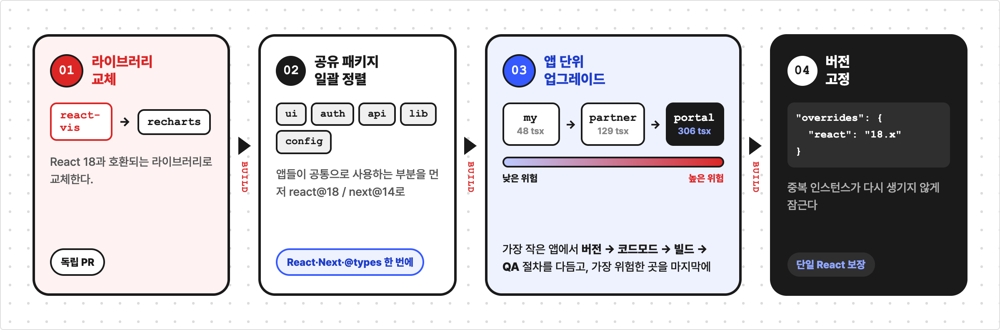

# React 18 마이그레이션 2/4 실행편: “migration 해줘”라고 할 수 없는 이유

[!note] 본 게시글은 VTOV 기술 블로그에 공식 기고된 글입니다. [이 URL](https://career.vtov.kr/contents/tech/react-18-migration-2-execution)에서 원문을 확인할 수 있습니다.

> 본문의 파일 수·버전·API 변경은 실제 마이그레이션 시점의 코드와 각 라이브러리 릴리스 노트를 기준으로 합니다.
> 

안녕하세요. 1편에서 만난 개발자 이재원입니다. 지난 편에서 우리는 키보드에 손을 올리기 전에 “무엇을, 왜 손대야 하는지”를 근거 있게 정했습니다. React·Next는 18.2/14로, `react-vis`는 갈아타고, `swr`은 v2로, `next-auth`는 그대로 — 작업범위는 모두 산정되었습니다.

그럼 이제는 실행입니다! 두 가지만 더 신경 쓴다면 지금까지 보다는 쉬운 작업이 될 것이에요. 첫번째는 “**순서”**입니다. 저희가 작업해야 하는 폴더와 파일의 개수는 수백 개를 아우릅니다. 어떤 차례로 어떤 작업을 먼저 하느냐에 따라 같은 일을 두번하도록 반복될 수도 있습니다. 다른 하나는 **자동화의 사각지대**입니다. 코드모드가 대부분을 진행해주겠지만, 도구가 작업하지 못하는 부분을 신경써주어야 합니다. 코드모드에 대한 자세한 설명은 이후 본문에서 만나보도록 하시죠.

이번 편은 그 실행의 기록입니다. 그리고 1편에선 은근히 뒤에 뒀던 이야기 “**AI 에이전트와 실제로 코드를 어떻게 나눴고 고쳤는지”** 를 본격적으로 풀어볼게요.

---

## React 18을 막는 라이브러리부터 떼어낸다 — `react-vis` → recharts

가장 먼저 한 일은 마이그레이션 본 작업은 아니었습니다. React 18을 아예 못 올리게 막는 `react-vis`부터 치웠습니다. 1편에서 봤듯 이 라이브러리는 React 16까지만 지원해서, 버전을 올리는 게 아니라 **다른 라이브러리로 갈아타야** 했죠. portal의 차트 3개를 recharts로 다시 그렸습니다.

이걸 **별도 PR로, 그것도 제일 먼저** 한 데는 이유가 있어요. recharts는 React 17에서도 18에서도 돌거든요. 그러니 이 교체 PR은 아직 React 17인 상태에서 단독으로 머지할 수 있었고, 그만큼 위험이 프레임워크 업그레이드와 **섞이지 않았습니다.** 큰 변경일수록, 떼어낼 수 있는 위험은 미리 떼어내는 게 이득이라 판단했어요.

문제는 두 라이브러리의 API가 꽤 다르다는 거였어요. react-vis는 `<XYPlot>` 안에 시리즈를 쌓는 방식인데, recharts는 `<BarChart>`·`<ScatterChart>` 같은 차트별 컨테이너를 씁니다. 그래서 차트 요소를 하나하나 대응시켜야 했어요.

| react-vis | recharts | 무엇 |
| --- | --- | --- |
| `VerticalBarSeries`(스택) | `<Bar stackId>` | 배송완료/보류/중단/분실 스택 막대 |
| `MarkSeries` + `WhiskerSeries` | `<Scatter>` + `<ErrorBar>` | 고객사 출고수 평균 ± 표준편차 |
| `Hint` | `<Tooltip>` | 호버 툴팁 |
| `Crosshair` | `<ReferenceLine>` | 현재 시각·SLA 리밋 같은 기준선 |
| `DiscreteColorLegend` | `<Legend>` | 범례 |
| `XYPlot` / `makeWidthFlexible` | `<ResponsiveContainer>` | 반응형 레이아웃 |

가장 단순한 스택 막대 하나만 놓고 봐도, 두 라이브러리의 사고방식 차이가 드러나요.

```jsx
// Before — react-vis: <XYPlot> 안에 시리즈를 쌓는 방식 (stackBy로 누적)
<XYPlot width={480} height={240} stackBy="y">
  <VerticalBarSeries data={completed} />
  <VerticalBarSeries data={onHold} />
  <Hint value={hovered} />
</XYPlot>

// After — recharts: 차트 컨테이너 + 요소 컴포넌트를 조합 (stackId로 누적)
<ResponsiveContainer width="100%" height={240}>
  <BarChart data={rows}>
    <Tooltip />
    <Bar dataKey="completed" stackId="s" />
    <Bar dataKey="onHold" stackId="s" />
  </BarChart>
</ResponsiveContainer>
```

> 이해를 돕기 위해 단순화한 예시입니다.
> 

이건 사실 마이그레이션의 영역이 아니죠. 라이브러리를 교체하는 작업이기에, 차트마다 “이 그림을 recharts로 어떻게 다시 그리지”를 사람이 설계해야 하는 재작성이었어요. 다행히 portal엔 이미 `d3`·`reactflow`가 있어 시각화 라이브러리 하나 더 들이는 부담은 크지 않았습니다. 그리고 데이터·축·툴팁·기준선이 **원래 차트와 눈으로 같은지**는 개발 서버를 띄워 하나씩 대조했어요.

---

## 그다음은 순서 — 공유 패키지에서 앱으로

React 18을 막던 `react-vis`를 치웠으니 이제 본 작업입니다.  한꺼번에 다 바꾸고 빌드를 돌리면, 빨간 에러 수백 개 앞에서 “이게 어디서 왔지”를 영영 못 찾습니다. 그래서 위험을 잘게 나눠 한 조각씩 확인하며 갔어요.

- **React·Next·`@types`는 한 번에 올린다.** 1편에서 본 이유 그대로, 부분 업그레이드는 중복 React 인스턴스(`Invalid hook call`)를 부르기 때문입니다.
- **공유 패키지 → 앱 순으로.** 앱들이 공통으로 사용하고 있는 `@today/{ui,auth,api,lib}`와 `packages/config`를 먼저 18/14로 작업했습니다.
- **낮은 위험 앱 → 높은 위험 앱 순으로.** 앱은 **`my`(48 tsx / 배송추적 플랫폼) → `partner`(129 / 주문 플랫폼) → `portal`(306 / 배송관리 내부 백오피스)** 순으로 올렸어요.

마지막 순서가 특히 중요했는데요. `my`는 가장 작고 단순해서, 여기서 “버전 올리고 → 코드모드 → 빌드 → QA”라는 절차를 **처음 밟아보며 다듬기** 좋았어요. 그렇게 절차가 안정되면 `partner`,  그리고 마지막에 `portal`을 작업했습니다. portal은 306개 파일에 MQTT 실시간 모니터링, Naver Maps, `swcMinify`, 방금 갈아낀 recharts 차트까지 얹힌 제일 규모가 큰 앱이기에 위험도가 높다고 판단했거든요. **가장 위험한 곳을, 절차가 가장 손에 익은 마지막에** 두는 거죠.



범위를 나누는 게 1편의 일이었다면, **실행을 나누는 게 2편의 일**이었습니다. 이 순서 덕분에 뭔가 깨지면 “방금 만진 이 부분”에서 왔다는 게 늘 분명했어요.

---

## 반복은 에이전트에게 — 코드모드와 일괄 정렬

순서를 정했으니, 이제 손이 많이 가는 반복 작업 차례예요. 그리고 이런 일이야말로 AI 에이전트에게 맡기기 딱 좋았습니다. 본격적으로 에이전트에게 일임하기 이전에 react와 next에서 지원해주는 코드모드에 대해 알아볼게요.

**코드모드(codemod)** 는 소스 코드를 자동으로 고쳐 쓰는 스크립트예요. 핵심은 단순한 "찾아 바꾸기"가 아니라는 점입니다. 글자만 훑는 게 아니라 코드의 문법 구조 — 흔히 AST(abstract syntax tree, 코드를 트리 모양으로 해석한 것)라고 부르는 것 — 를 이해하고 바꾸거든요. 덕분에 "`<Link>` 안에 들어 있는 `<a>`"처럼 **구조로 규칙을 정의**할 수 있고, 따옴표나 줄바꿈이 조금 달라도 같은 패턴이면 정확히 찾아냅니다.

React나 Next 같은 큰 프레임워크는 메이저 업그레이드에서 이렇게 손봐야 할 패턴이 수백 곳씩 생깁니다. 그걸 사람이 일일이 고치는 건 비현실적이라, 프레임워크 팀이 아예 **공식 코드모드**를 함께 내놓아요. `npx @next/codemod@latest <변환 이름> <경로>` 한 줄이면 그 규칙에 맞는 파일들을 알아서 다시 써줍니다. 우리가 쓴 것도 전부 Next가 공식으로 제공하는 변환이었어요.

다만 미리 귀띔하면, 코드모드는 **자기가 확신하는 패턴만** 건드리고 애매하면 그냥 둡니다. 이 "그냥 둔" 것들이 나중에 어떤 문제로 발전됐는지는 조금 뒤에서 만나게 될 거예요.

가장 파일 수가 많았던 건 `<Link>` 패턴 변경이었어요. Next 13부터 `<Link>`가 `<a>`를 자동으로 렌더하거든요. 기존의 “`<a>`를 직접 넣던” 옛 방식은 전부 바꿔야 했는데, 그런 파일이 **38개**(portal 26 / partner 10 / my 2)였습니다.

```jsx
// Before — legacy: <a>를 직접 넣고 passHref로 href를 넘김
<Link href="/orders" passHref>
  <a className="nav-link">주문</a>
</Link>

// After — Next 13+: <Link>가 <a>를 자동 렌더, className도 직접 받음
<Link href="/orders" className="nav-link">
  주문
</Link>
```

이걸 38개 파일에서 손으로 고치는 건 지치는 일이죠. 다행히 Next가 공식 코드모드를 줍니다. 에이전트에게 “각 앱에 코드모드를 돌리고 결과를 정리해줘”라고 맡겼어요.

```bash
npx @next/codemod@latest new-link apps/my                     # <Link> 38개 파일
npx @next/codemod@latest next-image-to-legacy-image apps/my   # next/image 8개 파일
```

`next/image`는 8개 파일뿐이라, 일부러 신버전으로 곧장 안 가고 `next/legacy/image`로 **안전하게 먼저** 옮겼어요. 레이아웃이 깨질 위험을 한 번에 떠안기보다, 동작을 유지한 채 넘긴 뒤 나중에 여유 있을 때 신버전으로 가려는 판단이었습니다.

정형화된 설정 변경도 에이전트 몫이었어요.

- **`transpilePackages` 이전** — 공유 패키지를 트랜스파일하던 `next-transpile-modules` 플러그인을 Next 내장 옵션으로 옮기고, 플러그인 devDependency는 삭제했습니다. 재밌는 건 **앱마다 목록이 달랐다**는 거예요. portal·partner는 `@today/{api,auth,lib,ui}` 넷을 쓰는데, `my`는 인증을 안 써서 `auth`가 빠진 셋만 필요했거든요. “다 똑같겠지” 하고 복붙했으면 틀렸을 지점입니다. 이전 1편에서 우리 서비스의 현재 구조도를 그려본 이유도 이 때문이에요.

```jsx
// next.config.js  —  Before: 플러그인으로 감쌈
const withTM = require("next-transpile-modules")([
  "@today/api", "@today/auth", "@today/lib", "@today/ui",
])
module.exports = withTM({ reactStrictMode: true })

// After: 내장 옵션 (my는 auth가 빠진 셋)
module.exports = {
  reactStrictMode: true,
  transpilePackages: ["@today/api", "@today/auth", "@today/lib", "@today/ui"],
}
```

- **`eslint` 7.32.0 → `^8.57.0`, `@types/node` → `^18.x`** — 둘 다 1편에서 “프레임워크에 딸려 올라온 조연들”로 만났던 애들이죠. `eslint-config-next@14`가 eslint 8을 요구하니 앱마다 함께 올렸어요.
- **`@sentry/nextjs` 6 → 7** (my/partner/portal) — 이건 살짝 신경 쓰였어요. 6.x가 Next 14와 호환이 안 돼 7로 올려야 했는데, `withSentryConfig`와 `sentry` 옵션의 API가 바뀌어서 각 앱 `next.config.js`(`silent`·`hideSourceMaps`·`disableServerWebpackPlugin` 등)를 손으로 맞춰야 했습니다.

그리고 버전을 올린 뒤엔 **빌드가 스스로 할 일을 알려줬어요.** `@types/react`를 18로 올리자 타입 에러가 우수수 떴는데, 대부분 “React 18에서 `React.FC`가 더 이상 `children`을 자동으로 안 품는” 변화 때문이었습니다. 다행히 우리 코드베이스는 이미 `PropsWithChildren`를 표준으로 쓰고 있어서 손볼 곳이 생각보다 적었어요. 이런 건 런타임까지 안 가고 컴파일에서 다 드러나니, 빌드 로그를 따라 하나씩 지우면 되는 비교적 마음 편한 작업이었습니다.

---

## 코드모드는 80%까지만 — 사람이 지켜야 하는 20%

코드모드를 돌리고 빌드를 띄웠는데, 몇몇 화면에서 링크가 이상하게 동작했어요. 범인을 찾아보니, `<Link>`의 자식이 평범한 `<a>`가 아니라 **baseui 컴포넌트**인 케이스였습니다.

```jsx
// Before — 코드모드가 확신 못 하고 그냥 둔 상태 (<Link> 자식이 baseui <StyledLink>)
<Link href="/orders" passHref>
  <StyledLink>주문</StyledLink>
</Link>

// After — 사람이 판단해 legacyBehavior를 명시 (커스텀 <a> 컴포넌트를 자식으로 유지)
<Link href="/orders" legacyBehavior passHref>
  <StyledLink>주문</StyledLink>
</Link>
```

코드모드는 “`<Link>` 안의 `<a>`”라는 뻔한 모양은 잘 바꿔주지만, `<Button $as="a">`나 `<StyledLink>`처럼 **한 겹 감싼 형태**는 확신하지 못하고 그냥 둡니다. 이게 왜 위험하냐면, 코드모드가 건드리지 않으니 에러도 안 나고, 화면도 얼핏 멀쩡해 보이거든요. 그런데 클릭 동작이나 `href` 전달이 미묘하게 어긋나 있죠. 그래서 이런 곳은 사람이 하나씩 열어, 위 예시처럼 `legacyBehavior`를 붙여 옛 동작을 유지할지 아니면 `<StyledLink>`를 걷어내고 `<Link>`에 스타일을 직접 넘길지를 판단해야 했어요.

이 지점에서 AI와의 분업이 선명해집니다. **뻔한 80%를 빠르게 쳐내는 건 에이전트가 압도적으로 빨랐어요.** 하지만 “이 컴포넌트는 내부에서 `href`를 어떻게 쓰지?”처럼 맥락을 읽어야 하는 나머지 20%는, 결국 사람이 코드를 읽고 정해야 했습니다. 코드모드가 남긴 건 “다 됐다”가 아니라 “여기까지 했으니 나머지는 확인해”라는 초안이었던 거죠.

---

## 같은 함수, 달라진 반환값 — swr v2 `cache.get()`

1편에서 이런 말을 했어요. “설치가 실패한 패키지보다, **조용히 통과한** 패키지가 더 위험했다”고요. 실행 단계에도 딱 그런 게 있었습니다. 이번엔 함수 이름도, 넘기는 인자도 그대로인데 **반환값의 의미만 바뀐** 코드였어요.

먼저 왜 `swr`을 v2로 올렸는지부터. v2는 React 18의 `useSyncExternalStore`(외부 스토어를 리액트 렌더링과 안전하게 동기화하는 API) 위에서 동작해요. 그래서 React 18과 정합이 잘 맞죠. 대신 이 라이브러리는 앱 세 곳(my/partner/portal)과 공유 패키지 `@today/api`·`@today/lib`까지 **다섯 곳이 나눠 쓰기** 때문에, 1편에서 배운 대로 다섯 곳을 동시에 올려야 했습니다.

버전을 올리자 대부분은 타입으로 드러났어요. `@today/api`의 `SWRConfiguration`·`SWRResponse`·`Key` 같은 타입이 v2에서 미세하게 바뀌어서(`isLoading` 추가 등), `tsc`가 “여기 타입이 안 맞아”라고 짚어줬거든요. 그런데 딱 한 종류, 타입으로도 잘 안 걸리고 조용히 지나가는 게 있었습니다. 캐시를 **직접 꺼내 쓰던** `cache.get()`이었어요.

```tsx
// Before (swr v1) — cache.get이 데이터를 '직접' 반환
const cachedData = cache.get(key)
cachedData.packageItems           // 바로 접근 OK

// After (swr v2) — cache.get이 '상태 객체'를 반환
//   { data, error, isLoading, isValidating }
const cachedData = cache.get(key)  // 이제 이건 상태 객체
cachedData.packageItems            // undefined — v1처럼 깨짐
```

고치는 건 한 줄이었어요. `cache.get(key)?.data`로 데이터를 한 겹 더 꺼내면 됩니다. 문제는 이 한 줄을 **찾아내는 일**이었죠. 시그니처가 그대로라 눈에 안 띄고, 코드모드 같은 자동 변환도 이런 “의미가 바뀐 반환값”은 손대주지 않습니다. 메이저 버전 업그레이드가 무서운 게 이 지점이에요. API가 겉보기엔 똑같아도 내부 구현체가 달라져있는 부분이 있을 수 있다는 것이죠.

이건 결국 라이브러리의 v2 변경점을 읽고, “우리 코드에서 `cache.get`을 이렇게 쓰는 데가 있었지”를 떠올려 직접 찾아 고치는 수밖에 없었어요. 에이전트에게 “swr v2에서 바뀐 API를 우리 코드에서 찾아줘”라고 폭넓게 훑게 하되, **정말 그렇게 바뀌는지는 릴리스 노트와 실제 동작으로 사람이 확인**했습니다. 1편에서 세웠던 원칙 그대로였어요. 에이전트에게 업무는 수행시키되, 그 사실 검증은 개발자 몫으로 가져가는 것, 이게 실행 단계에서도 통했습니다.

> 반대로 안전하게 놔둔 것도 있습니다.. `<SWRConfig value={{ fetcher }}>`처럼 fetcher만 넘기는 부분은 v2에서도 동작이 같아 건드리지 않았고, `swr/infinite`·`swr/immutable` 서브패스의 import 경로도 그대로였습니다. 모든 라이브러리에 대한 모든 변경사항에 개발자가 팔로잉할 순 없겠죠. 그렇지만 지금처럼 대규모 마이그레이션이 진행될 때에, major 버전을 올리는 경우 CHANGE_LOG는 꼭 확인해야 할 문서 중 하나입니다.
> 

---

## 매 단계, 빌드로 잡는다

지금까지의 이야기를 순서대로 진행하기 위해서는 이전 단계에 마침표를 찍어줄 필요가 있습니다. 저는 이번 migration 작업에서는 이것을 빌드로 정하였고, AI에게는 “빌드게이트”라는 이름으로 각 단계 후 빌드 검증을 수행하도록 지침해두었어요. 각 단계를 끝낼 때마다 아래를 순서대로 통과시키고, **통과 못 하면 다음 단계로 넘어가지 않았습니다.**

```bash
pnpm --filter @today/api build   # ① 공유 패키지 단위: tsc 0 오류
pnpm run build:my                # ② 앱 단위: 타입/번들 0 오류
pnpm run build && pnpm run lint  # ③ 전체: 전 패키지 성공
pnpm ls react react-dom next     # ④ 정합: 단일 버전인지 (중복 인스턴스 방지)
```

이게 지루해 보여도, 실은 위험을 순서로 나눈 보람을 여기서 회수해요. 방금 본 `@types/react` 18 타입 에러도, swr v2 타입 변화도 전부 이 게이트에서 확인되었거든요.(그리고  귀찮고 반복적인 일을 시킨다고 AI는 불평하지 않죠.) `my`에서 게이트를 통과시키며 절차를 다듬어두면, 같은 절차를 `partner`·`portal`에 반복할 때 훨씬 안전했습니다. 그리고 마지막에 루트 `package.json`의 `pnpm.overrides`로 React를 단일 버전에 고정해, 간접 의존성이 몰래 다른 React를 끌어오는 것까지 작업했습니다.

```json
// 루트 package.json — 간접 의존성까지 React 버전을 강제
"pnpm": {
  "overrides": { "react": "18.2.0", "react-dom": "18.2.0" }
}
```

게이트는 “빨리 가는 법”이 아니라 “되돌아오지 않는 법”이었어요. 한 단계라도 초록불을 못 보면 멈췄기 때문에, 뒤늦게 “어디서 깨졌지”를 파헤치는 일이 없었습니다.

---

## 정리 — 순서로 나누고, 빌드로 잡고, 20%는 사람이

돌아보면 2편의 실행은 세 문장으로 요약돼요. **위험을 순서로 나눴고, 매 단계 빌드 게이트로 회귀를 즉시 잡았고, 자동화가 못 보는 20%는 사람이 지켰습니다.** React 18을 막던 라이브러리를 먼저 떼어낸 것도, 작은 앱부터 올린 것도, 코드모드 뒤를 사람이 검수한 것도 전부 “한 번에 무너지지 않게” 하려는 같은 원칙이었어요.

AI 에이전트와의 분업은 본문 내내 보신 그대로예요. 반복은 맡기고, 판단은 제가 쥐었죠. 다만 이번을 겪고 나니 새로운 질문이 하나 남더라고요. **다음엔 맡기는 범위를 얼마나 더 넓힐 수 있을까?** 이번엔 사람이 자동화 뒤의 20%를 전부 지켰지만, 예컨대 “swr v2에서 반환값이 바뀐 API를 찾아 고쳐줘”까지 맡기고 저는 그 진단이 맞는지만 확인하는 식으로, 사람이 지킬 자리를 조금씩 좁혀갈 수도 있겠다 싶었어요. 혹은 AI는 충분히 잘 작동하니 불필요한 프롬프팅일 수도 있겠죠. 이런 고민들은 다음 마이그레이션의 숙제로 남겨두고 글을 줄이려 합니다.

> 자동화는 지루한 80%를 대신 해준다. 하지만 나머지 20%, 도구가 확신 못 하는 예외는 결국 사람이 읽고 판단해야 한다.
> 

순서를 더 잘게 쪼갤 수도, 더 많은 게이트를 신설하여 작업을 빡빡하게 진행할 수도 있었겠죠. 그래도 “큰 변경일수록 한 번에 하지 말고, 나눠서 확인하며 가라”는 감각이 전해졌다면 좋겠습니다. 사실 migration 경험기는 이번 편이 마지막일 예정이었어요. 그런데, 이렇게 작업했다 하더라도 결국 장애를 마주하고 말았습니다. 다음 편에서 빌드 게이트 이외에 어떤 QA를 진행했었는지 그리고 결국 어떤 장애를 마주쳤는지로 돌아올게요 !

---

### 참고

- [Next.js codemods (`@next/codemod`)](https://nextjs.org/docs/app/building-your-application/upgrading/codemods)
- [SWR v2 마이그레이션 가이드](https://swr.vercel.app/docs/migration)