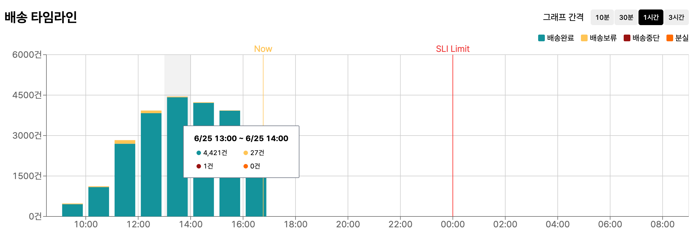
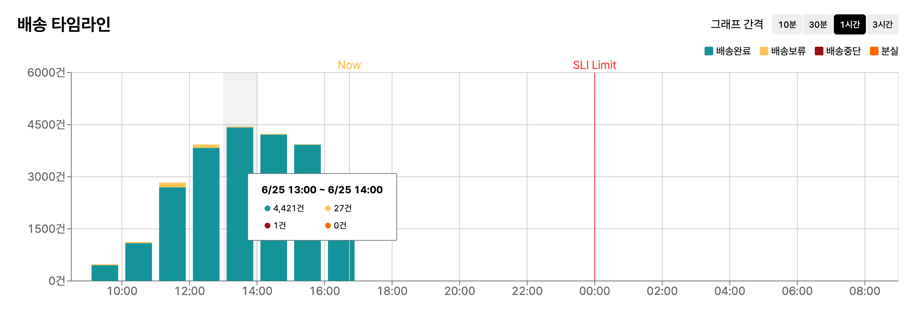
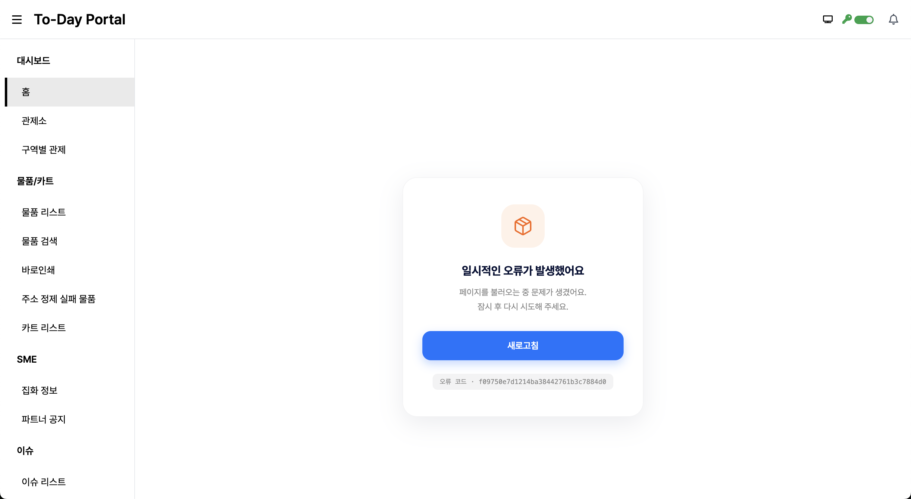
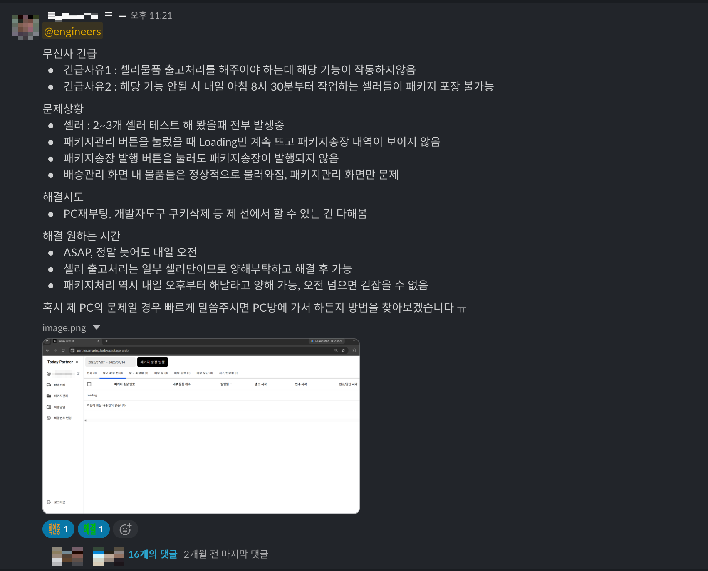

# React 18 마이그레이션 3/4 검증편: 장애는 찾아온다.

[!note] 본 게시글은 VTOV 기술 블로그에 공식 기고된 글입니다. [이 URL](https://career.vtov.kr/contents/tech/react-18-migration-3-verification)에서 원문을 확인할 수 있습니다.

안녕하세요. 1편·2편에 이어 돌아온 개발자 이재원입니다. 오늘은 마이그레이션 일대기 마지막으로 QA를 이야기해고보자 합니다. 지난 두 편에서 저희는 신중하게 한 계단씩 올라갔습니다. 1편에서 코드를 만지기 전에 무엇을, 왜 작업해야 하는지 설계했고, 2편에서 위험도를 기준으로 순서를 나눠 매 단계 빌드로 확인하며 실행했습니다. 실제로 마지막에는 우리의 서비스들을 `✓ Compiled successfully` , 타입 에러 0건, lint 통과로 최종 과정에서 green build를 이루어냈습니다.

그런데 이 사인만 보고 배포 할 수는 없었어요. 1편에서 빌드를 암묵적으로 통과한 `react-vis`를, 2편에서는 `cache.get`을 이미 겪으며 우리는 빌드의 통과가 곧 서비스의 안정성을 뜻하지 않는다는 것을 배웠습니다. 빌드가 초록불이란 것은 “컴파일이 되었다”라는 뜻이지, 우리의 “비즈니스 로직을 온전히 보존했다.”가 아니었습니다. 아무리 잘 계획하고, 차분히 실행해도 QA는 반드시 필요한 일이었어요. 

그래서 이번 편은 두 부분입니다. 첫 번째는 배포 이전 최종적으로 실행한 QA 과정을 그리고 두 번째는 부끄럽지만 그럼에도 불구하고 마주치게 된 버그 케이스를  나눠보고자 해요.

## 빌드는 “컴파일”의 성공이다.

먼저 왜 빌드로는 부족했는지부터. 이번 마이그레이션의 회귀 중 상당수는 예외를 던지지 않습니다. hydration이 어긋나도, SWR 동작이 바뀌어도, 대개 `throw` 없이 `console.error` 한 줄 남기고 조용히 넘어가죠. 그러니 전역 에러 핸들러나 `try/catch`로도, 타입 체크로도 안 잡힙니다.

빌드는 "이 코드가 컴파일되는가"까지만 답해줘요. "이 화면이 실제로 사용자 앞에서 제대로 도는가"는 다른 영역에서 확인해야 했습니다.

### 1. **눈으로 정답지를 확보한다.**

거창하게 QA로 서문을 시작하고, 눈으로 바라보는 것이 나와서 실망하신 분들도 있으실 것 같은데요. 반드시 필요한 과정입니다. 2편에서 진행했던 코드모드의 결과물에 대한 실 검증의 역할도 겸해서요. 그럼에도 거대한 app의 모든 path와 모든 동작을 직접 눈으로 검증하는 것은 여간 부담스러운 일이 아닐 것입니다. 전문 QA 파트의 인원과 주어질 수 있는 시간이 충분하다면 물론 가장 안전한 방법이겠지만 (또 그렇게 진행하지 못해 아쉽지만) 효율적으로 일을 진행할 필요성이 있었습니다.

지금처럼 진행되는 마이그레이션 기본 골자는 diff를 파악하는 데에 있습니다. react와 next의 같이 기본 뼈대가 되는 경우는 코드모드의 도움을 받았으니 기본적인 화면과 동작이 정상적으로 도는 것을 인지하는 것으로 수고를 많이 덜 수 있고, major 버전이 변경된 thrid-party 라이브러리나, 교체된 라이브러리의 검증이 우선된다고 판단했습니다. 저희의 경우에는 swr과 rechart가 되겠네요.

swr 같은 경우는 cache를 담당하는 key의 형태가 변경되었습니다. 그래서 이번 단계에서는 네트워크를 직접 까보고 요청의 URL·헤더·응답을 눈으로 확인했습니다. swr을 쓰는 패턴(상황마다 다르겠지만 저는 method 별로 하나씩 꼽아서 진행했습니다.)을 하나씩 선정하여 해당 동작을 검증하여 정답지를 확보했습니다. 정답지를 확보했다면 다음은 해당 정답지로 미루어보며 다른 경우들이 올바르게 설계되어 있는지를 검수하는 것으로 진행하였습니다. AX적인 시각에서 표현하자면 AI에게 올바른 예시를 전달해주기 위한 프롬프팅의 전처리 과정으로 볼 수도 있겠네요.

이렇게 대표적인 페이지와 케이스를 살펴보면서 의외로 저를 불안하게 만들었던 것은 “정상 노이즈”였습니다. 가장 기억에 남는 예시로는 Sentry 429에러가 있겠네요. 우리의 콘솔창을 붉게 물들며 불안하게 만들지만 이는 SDK가 보낸 이벤트를 서버가 rate-limit한 것으로 오히려 마이그레이션한 Sentry 7 클라이언트가 정상 동작 중이라는 증거였습니다. 또 네이버 지도 타일의 `ERR_ABORTED` 도 마주쳤었는데 지도를 pan/zoom할 때 취소된 요청으로 마찬가지로 에러는 아니었습니다. 지금까지 차근차근하게 진행해온 만큼 불안해하지 않고 QA를 이어가나는 길이 남은거죠 !

### 2. 차트는 원본과 대조한다.

방금 저희의 경우 중 하나로 rechart가 있다고 말씀 드렸었죠? 이번 마이그레이션을 통해 기존 차트의 시안성을 확보하는 등의 고도화를 진행했다면 새로운 featrue를 개발하는 것처럼 작업을 이어나갈 수 있었겠지만 사용자 누구도 모르게 우리 내부의 구성품들을 최신화하는 것에 목적이 있었습니다. 이에 “원본이 보여주고 있는 항목들을 같은 가시성으로 올바르게 구현했는지”가 검증 대상이었는데요. app 여러 군데에 흩어져 있는 차트를 여러 데이터로 비교, 대조해보는 것은 여간 귀챃은 일이 아닐 수 없기 때문에 agent의 힘을 빌렸습니다.

그래서 이 반복 캡처를 에이전트에게 chrome devtools를 쥐여주고 맡겼어요. 에이전트가 각 차트 화면에 접속해 기본 상태를 찍고, 막대에 호버를 걸어 툴팁이 뜬 상태까지 재현해 스크린샷을 뜨는 식으로요. 그것도 원본(react-vis) 빌드와 교체본(recharts) 빌드 양쪽에서 같은 케이스를 떠서 `origin` / `migration` 쌍으로 쌓았습니다. 이렇게 모은 스크린샷을 나란히 놓고 한 번에 대조하며 판단했습니다. 그래프를 구성하는 막대와 축부터, 호버 툴팁, 여러 부가적인 요소와 마커등을 최대한 많은 케이스에서 빠르게 진행할 수 있었어요. 





좌: origin / 우 : migration

### 3. 넓고 반복적인 작업은 기계가 더 잘한다.

2편에서 “코드모드는 80%까지만 해주고, 나머지 20%는 사람이 지켜야 한다”고 했던 것 기억하시나요? 그 말을 뒤집으면 그 80%처럼 넓고 반복적인 일은 기계가 사람보다 훨씬 잘한다는 뜻이기도 해요. 화면을 아무리 눌러봐도, 306개 파일짜리 portal에서 안 눌러본 경로는 늘 남아요. 그래서 눈으로 못 훑는 패턴은 스크립트로 전수 검사했습니다. 코드모드의 결과를 확인해봐야죠!

React 18은 무효한 HTML 중첩에 예전보다 엄격하게 관리되기에 태그 스택을 쌓아가며 `<button>` 안의 `<button>`, `<a>` 안의 `<a>` 같은 무효 중첩을 전 파일에서 에이전트로 패턴을 찾아냈고, 결과는 10건이었습니다.

이게 왜 문제냐면 hydration 때문이에요. Next는 서버에서 HTML을 미리 그려 보내고, 브라우저에선 React가 그 HTML 위에 이벤트·상태를 덧 입힙니다. 이 과정을 hydration이라고 불러요. 그런데 서버가 보낸 HTML과 React가 기대한 구조가 어긋나면 이 과정이 실패합니다. 가장 대표적인 케이스가 브라우저가 페이지를 읽으면서 무효한 구조를 제멋대로 교정해 버리는 경우입니다. (예: `<a>` 안의 `<a>`를 바깥으로 풀어헤칩니다). 그러면 브라우저가 실제로 그린 구조와 React가 기대한 구조가 달라지죠.

그럼 이게 런타임에 진짜 버그가 되냐 하면, 조금 결이 달라요. hydration 불일치의 시끄러운 빨간 경고는 대부분 개발(dev) 빌드에서 뜨고, 프로덕션 빌드에선 조용합니다. 그래서 "개발 중에만 나는 에러 아닌가?" 싶기 쉬운데, 절반은 맞는 말이에요. 다만 조용하다고 없는 일이 되는 건 아닙니다. hydration이 실패하면 React는 서버가 그려 보낸 HTML을 버리고 브라우저에서 그 부분을 다시 그리거든요. 그래서 프로덕션에도 이런 게 남아요.

- **깜빡임·레이아웃 이동** — 서버가 그린 화면이 잠깐 보였다가 클라이언트 렌더로 교체되며 흔들릴 수 있어요.
- **SSR 이점 상실** — 그 영역은 서버 렌더의 빠른 첫 화면·SEO 이점을 잃습니다. 어긋남이 크면 페이지 전체가 클라이언트 렌더로 폴백되기도 하고요.
- **어긋난 마크업** — 무효 중첩은 브라우저가 구조를 재배치하니, 의도한 DOM과 달라져 스타일이나 접근성(스크린리더·키보드 포커스)이 어긋날 수 있어요.

app이 crash되는 버그는 아니지만, 안고 갈 수 있을만큼 무감각하게 대할 수 있는 영역도 아니죠. 방치하고 이런 것들이 쌓이면 프로덕션에서 품질 저하로 이어진다고 판단했어요.

실제로 my(배송추적 서비스)의 개인정보 동의 체크박스 컴포넌트가 그런 경우였는데, 그중 한 화면에서는 스캔이 찍은 그대로 런타임에서 hydration이 어긋나는 걸 확인했습니다. 고치는 건 단순했어요. 겹친 요소 중 하나를 걷어내거나(`<a>` 안 `<a>`는 링크 하나로 합치고), 클릭 기능만 남긴 다른 태그로 바꿔(안쪽 `<button>`은 `role="button"`을 준 `<span>`으로) 중첩을 펴주면 됐습니다. 이런 스캔 작업과 변경 작업은 에이전트에게 맡기기 좋은 일이었어요. 넓고 반복적인 일이니까요. 우리 친구 AI는 저에게 다음과 같이 보고를 작성해주었어요.

```json
## 🔴 Invalid interactive HTML nesting 스윕 — 10건 발견 및 수정

React 17은 hydration 시 무효 중첩을 관대하게 넘겼으나, **React 18은 치명적으로 처리**한다. 특히 브라우저 HTML 파서가 SSR 결과를 재구성하는 `<a>`안 `<a>`, `<button>`안 `<button>`은 hydration 실패 → (Suspense 밖이면) **루트 전체가 클라이언트 렌더링으로 전환**되어 SSR이 무력화된다.

### SSR-breaking (5건) — 파서 재구성 → hydration 실패

| 앱 | 파일:라인 | 패턴 | 수정 |
| --- | --- | --- | --- |
| my | `components/track/PrivacyCheckbox.tsx:26` | `button>button` | 안쪽 `<button>` → `<span role="button" tabIndex onKeyDown>` |
| partner | `components/common/CutOffTimer.tsx` | `a>a` (a>StyledLink) | 바깥 `<a>` 제거, `<StyledLink href target rel>`로 통합 |
| portal | `components/loads/LoadDetailDrawer/LoadAction.tsx` | `a>a` | 동일 |
| portal | `components/alimtalks/templates/TemplateTable.tsx` | `a>a` | 동일(`<div>` 래퍼 유지) |
| portal | `components/billings/BillingDetailDrawer.tsx` | `a>a` | 동일 |

- `my/PrivacyCheckbox`는 고객용 **4개 페이지**(unhold-delivery·unhold-collect·ready-to-collect·update-receiver-info)에서 사용되며, `unhold-delivery`에서 hydration 실패를 **런타임으로 확인**함.

### warning-only (5건) — `a>button`, dev 경고만(파서 재구성 없음, hydration 정상)이나 무효 HTML이라 함께 수정

| 앱 | 파일:라인 | 수정 |
| --- | --- | --- |
| partner | `pages/billings/index.tsx` | `<a><Button>` → `<Button $as="a" href target rel>` |
| partner | `pages/billings/[billingId].tsx` | 동일 |
| partner | `components/points/PointChargeBox.tsx` | 동일 |
| portal | `components/billings/ManuallyCreateBillingTab.tsx` | 동일 |
| portal | `components/billings/UpdateOrderShippingFeesTab.tsx` | 동일 |

- `Button $as="a"`: baseui `Button`은 `restProps`(href/target/rel)를 root 엘리먼트로 spread하므로(button.js), 단일 `<a>`로 렌더됨. 레포에 기존 선례(`CSTicketsPage`) 있음.
```

### 4. 모니터링 시스템을 확보하자.

QA를 아무리 해도 사람이 모든 걸, 매 배포마다 볼 순 없어요. 그래서 배포 이후를 위한 에러 탐지 환경 구축이 필요했어요. 애초에 Sentry 버전이 올라간 이유도 이 때문이죠. 목표는 하나였어요. "사용자가 서비스를 못 쓰게 되는" 에러를 빠르게 잡는 것.

- 렌더 크래시 → 각 앱 `_app`에서 화면을 `Sentry.ErrorBoundary`로 감쌌어요. 렌더 중 터진 에러를 어느 컴포넌트에서 터졌는지(컴포넌트 스택)와 함께 Sentry로 보내고, 흰 화면 대신 공통 fallback UI를 띄웁니다. 이 fallback엔 Sentry `eventId`를 "오류 코드"로 노출해서, 사용자가 제보하면 그 코드로 대시보드에서 바로 찾을 수 있게 했어요. (사용하는 유저가 모두 사내 관계자인 백오피스에서 유효한 방법이라 생각했어요.)



- 직접 쏜 요청의 실패 → 브라우저가 SWR로 도는 요청이 실패하면 SWR이 `error` 상태로 삼켜 Sentry까지 안 갔어요. 그래서 3개 앱 `SWRConfig`에 전역 `onError`를 달아, 401/403/404가 아닐 때만 Sentry로 보냈습니다. 인증·권한·미존재 같은 실패는 정상적이라 판단했어요.

이렇게 계획을 세우고, 실행했고, 검증했고, 대비했어요. 그리고 배포를 향했어요. 결말까지 유쾌하진 못했죠.

## 그럼에도 마주하고 말아버린

그럼에도 마주한 두 장애가 있어요. 형태는 비슷했어요. 둘 다 빌드는 통과했고, 예외(혹은 에러)를 throw하지 않아서 모니터링 시스템에서 탐지할 수도 없었죠. 단순 UI 구성도 틀리지 않았어요. 하지만 우리의 비즈니스가 올바르게 동작하지 못했고 Slack의 알람은 울리고 말았어요.

### 에이전트가 다 고쳤다고 믿었습니다: SWR 무한스크롤



첫 장애는 partner(주문 접수 플랫폼) 화면에서 나왔어요. 주문·물품 목록을 무한스크롤로 불러오는 화면인데, 배포하고 나니 ‘목록이 안 뜬다’는 제보가 올라왔습니다. 앱이 crash된 건 아니었어요. 딱 그 목록만 비어 있었죠. 

원인 자체는 이미 2편에서 다뤘던 내용이에요. SWR v2가 배열 키를 fetch에 spread하지 않는다는 변화죠. 이번에 무한스크롤(`useSWRInfinite`)에서 키를 배열로 감싸 넘기던 코드가 남아있었고, 그로 인해 요청에 실패하여 목록을 제송하지 못한 것이죠. 해당 매커니즘은 2편에서 다뤘으니 생략하고, 제가 이 장애를 마주하며 곱씹은건 버그 그 자체라기 보다는 “어쩌다 이게 배포까지 갔나”였어요.

이 swr 키 변경은 2편에서 제가 ‘넓고 반복적이니 에이전트에게 맡기자’고 계획했던 바로 그 작업이었어요. 그리고 QA에서도 정답지를 찾아 AI에게 한 번 더 검증을 부탁한 부분이기도하죠. 실제로 에이전트는 잘 해냈습니다 적어도 제가 넘겨준 정답지 모양(`useSWR([key, token])`)은요. 문제는 무한스크롤이 같은 'swr 키'라도 사용하는 hook이 달랐기 때문이라 파악되요. 에이전트는 대표 패턴을 일반화해 훑었기에 작업에서도, 검증에서도 온전히  진행되지 못한 것이죠.

조금 뼈 아픈건 역시 제 쪽입니다. 에이전트가 “swr 키 마이크레이션 정리했습니다.” 하고 결과를 내놓았을 때, 저는 한 번 더 검증을 맡기고 그것을 통과하는 것으로 “작업의 완수”라고 판단했거든요. 저는 swr을 method별로 정답지를 잡아 검증했는데, 정작 이 버그는 method가 아니라 '`useSWR`이냐 `useSWRInfinite`냐'에서 새워나왔죠. 여러 use-hook use case가 있다는 것을 제가 먼저 인지하고, 검증도 그 축으로 세웠어야 했는데 그러지 못한 거죠. 

## 장애 둘 — 스캔하고 나면 포커스가 사라졌다: React 18 자동 배칭

두 번째는 주문접수 키오스크에서 나왔어요. QR을 찍어 물품을 패키징에 담는 화면인데, **스캔을 한 번 하고 나면 입력창 포커스가 안 돌아왔습니다.** 키오스크는 바코드 리더가 입력창에 계속 포커스돼 있어야 다음 스캔이 되는데, 포커스가 풀리니 두 번째 스캔부터 먹통이 된 거죠.

코드는 이랬어요. 스캔 처리가 끝나면 `finally`에서 로딩 상태를 풀고(입력창 `disabled` 해제), 곧바로 포커스를 잡습니다.

```tsx
// Before — React 17에선 잘 동작하던 코드
} finally {
  setChildShippingId("")
  setIsLoadingJoinPackage(false)   // input의 disabled 해제
  inputRef.current?.focus()         // 곧바로 포커스
}
```

React 17에서는 이게 문제없었어요. `await` 뒤 `finally` 같은 비동기 콜백 안의 `setState`는 배칭되지 않고 **즉시 리렌더**됐거든요. 그래서 `disabled`가 먼저 풀린 뒤 `focus()`가 잡혔죠.

그런데 React 18은 자동 배칭(automatic batching) 이 생겼어요. Promise·`setTimeout` 같은 비동기 콜백 안의 `setState`들도 하나로 묶어 리렌더를 한 번으로 미룹니다. 그 바람에 `focus()`가 실행되는 시점엔 리렌더가 아직 안 일어나 입력창이 여전히 `disabled` 였고, 브라우저는 `disabled` 요소의 포커스 요청을 그냥 무시했습니다.

자동 배칭은 React 18로 올릴 때 익히 알려진 변경점이라 "조심하자" 했는데, 설마 키오스크 포커스에서 이렇게 드러날 줄은 몰랐어요. 해당 변경사항 때문에 우리의 어떤 로직이 문제가 발생할 수 있을까를 더 고민해보았어야했는데 부족했어요. 해법은 그 순간만 배칭을 풀어주는 것이었습니다. `flushSync`로 상태 변경을 감싸 먼저 동기로 리렌더(=`disabled` 해제)한 뒤 포커스를 잡게 했어요.

```tsx
// After — 그 순간만 동기 렌더를 강제
} finally {
  flushSync(() => {
    setChildShippingId("")
    setIsLoadingJoinPackage(false)   // 여기서 disabled가 먼저 풀린다
  })
  inputRef.current?.focus()           // 이제 포커스가 잡힌다
}
```

해당 버그는 반복 작업에서 두드러지는 경우이기에 배포 후 주요 feature가 정상 동작하는 지 실제로 수행하는 것 하나만으로는 확인하지 못했어요. 또, app에서 에러가 발생하는 것이 아니라 우리의 비즈니스 요구사항이 충족되지 못한 것이기 때문에 모니터링 시스템에서 탐지할 수도 없었죠. 

## 마치며

지금까지 AI와 함께 대규모 migration을 진행한 일대기를  이야기해보았습니다. 개인적으로 소회를 밝히자면 AI라는 강력한 무기를 이렇게 깊고 넓게 사용해 본 첫번째 경험이었습니다. 어떤 말로 글을 마무리지어야 할지 고민해보았는데, 이번 시리즈를 작성하면서 migration을 진행하게 된 목적을 말씀드린 적이 없었더라구요? 

당연히 오래된 package/lib을 최신화하여 서비스를 온전히 운영할 수 있도록 관리하는 것은 주기적으로 이루어져야하고 개발자에게 요구되는 업무가 맞습니다. 그런데 이번 작업은 해당 업무를 이행하는 것에 더해 한가지 더 다른 목적이 있습니다 바로 저희가 관리하고 있는 프로젝트의 코드와 품질을 현대화하기 위함이고, 그 첫 번째 초석으로 이번 migration이 필수적이라 생각했기 대문입니다.  

하루가 다르게 기술이 발전하고 있습니다. 이제 코드는 개발자들의 전유물이 아니게 되었죠. 기획자, 디자이너, QA, PM 모두 각자의 역할 아래에서 각자의 전문성을 AI agent라는 도구와 함께 프로젝트에 직접적으로 기여할 수 있는 시대가 되었다고 생각합니다. 해당 과정에서 너무 옛날의 버전, 너무 오래된 코드 패턴을 서비스에서 사용하고 있다면 생산성에 크게 저해될 것 같았죠. 

이렇듯 기술의 발전은 해당 기술을 어떻게 운용하여 우리의 비즈니스에 이바지할 수 있을지 그 숙제를 남깁니다. 이 일대기를 작성하는 시점에서 제가 사용했던 일련의 과정은 옛날 패턴이 되어 있을 수 있고, 여러분들이 이 글을 읽을 시점에서는 뒷쳐진 트렌드가 될지도 모릅니다. “단순히 AI를 사용했다”보다 AI를 어떻게 사용하고, 검증하고, 개발해나갈 수 있을지 그 호흡을 맞추는 과정을 여러분들이 느끼셨으면 좋겠습니다.