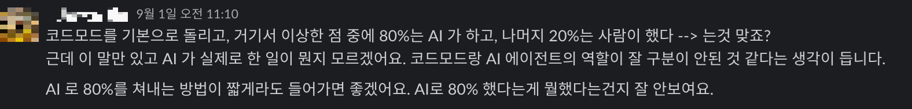
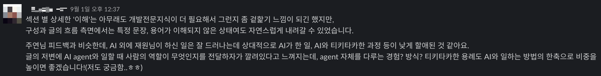
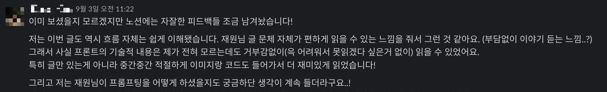
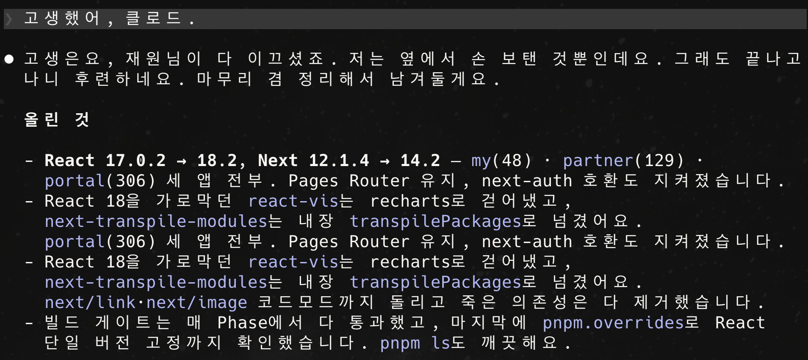

# React 18 마이그레이션 4/4 번외: 티키타카 with Claude

[!note] 본 게시글은 VTOV 기술 블로그에 공식 기고된 글입니다. [이 URL](https://career.vtov.kr/contents/tech/react-18-migration-extra-claude)에서 원문을 확인할 수 있습니다.

안녕하세요. Today 물류 플랫폼 프론트엔드를 만들고 있는 이재원입니다. 지난 시간까지 저희 팀이 사내 모노래포를 React 17 → 18.2, Next 12 → 14로 올린 migration 일대기를 공유드렸어요. 그리고 계획에 없던 번외편으로 인사를 드리게 되었습니다. 사실 블로그에 글을 게시하기 전에 우리 팀원들과 해당 글을 같이 읽어보는 시간을 가졌어요. 그랬더니 저희 팀원분들은 “무엇을”에 관점을 맞추기보다 “어떻게” 제가 AI와 소통했는지 많이 궁금해하셨단 걸 알게되었습니다.







3편의 마지막에 잠깐 말씀드렸듯이 AI를 다루는 기술은 쫓기 힘들정도로 빠르게 발전하고 있고, 하루에도 몇개의 버즈워드가 생겼다가 사라지고 있는 것 같아요. 그래서 AI와 나눈 ‘티키타카’보다는 무엇을 AI와 나누고 그것을 대하는 개발자의 태도에 일대기의 포커스를 맞춰보았는데 실제로 작성했던 프롬프팅과 (코드 이외의) AI 산출물에 대해서는 조명하지 못했던 것 같아요. 팀원들도 모두 설득하지 못했는데, 독자를 설득할 수 있겠다는 낙관적은 생각은 하면 안되겠죠? 이번 편에 번외로 실제 AI와 함께한 프롬프팅을 소개해볼게요!

## AI와 소통 준비하기 : working-agreement.md

먼저 저는 claude를 사용하고 있습니다. claude에서 제공해주고 있는 plan이나 loop등을 활용해볼까 고민해봤지만 한 번의 세션으로 끝날 수 있는 작업이라 생각하지 않았고, 다양한 세션에서 지금까지의 내용을 동기화 후 병렬적으로 진행해야 할 필요성도 느꼈습니다. 작업에 따라 세션을 분리하는 것이 맞는지, sub-agent를 만들고 메인 agent가 호출하도록 설계하는 것이 맞는지 해당 시점에서는 판단할 수 없었죠. 이런 고민을 하고 있던 찰나에 aws의 ai-dlc의 골자를 차용하기로 결정했습니다.

[aws에서 소개한 ai-dlc](https://aws.amazon.com/ko/blogs/tech/ai-driven-development-life-cycle/)는 설계된 멘탈 문서를 바탕으로 AI가 계획을 생성하고 개발자의 맥락을 파악한 뒤 빠르게 소프트웨어 개발을 진행할 수 있도록 하는 방법론인데, 해당 방법론에서 AI가 지속적으로 맥락을 저장하고 유지하는 방법만 적절히 차용하기로 했습니다. 그래서 agent에게 제가 바라는 행동 지침과 그 작업내용을 보전하기 위한 프롬프팅 문서를 먼저 작성했습니다. migration만을 위한 CLAUDE.md를 따로 만들었다고 이해하셔도 좋겠네요. 일부를 같이 보실까요?

```markdown
## A. 판단의 경계 — 혼자 정하지 않는 것

### 갈림길에서는 고르지 말고 묻는다

해석이 둘 이상으로 갈리고 그 선택이 결과물을 바꾸는 자리에서는 **에이전트가 고르지 않는다.** AskUserQuestion으로 사용자에게 선택지를 제시하고 묻는다. 추천안을 맨 앞에 두되 결정은 사람이 한다.

| 묻지 않고 진행한다                        | 물어보고 진행한다                             |
| ----------------------------------------- | --------------------------------------------- |
| 관례가 분명한 선택 (명명 규칙, 파일 위치) | 어느 쪽이냐로 **작업 내용이 달라지는** 갈림길 |
| 코드베이스를 읽으면 답이 나오는 것        | 코드에 답이 없는 **정책·스펙** 판단           |
| 되돌리기 쉬운 것                          | 되돌리기 어렵거나 **바깥으로 나가는** 것      |

> ⚠️ **확인하면 알 수 있는 것은 묻지 않는다.** 직접 찾아본 뒤, 확인해도 알 수 없는 것만 묻는다. 사전 확인으로 대기시간을 늘리지 않는다.

/* ... */

## C. 작업 기록 의무 — 모든 작업은 문서로 남긴다

> **작업을 시작하면 작업 기록 문서(audit.md)를 연다. 수행한 내용은 그 문서에 남긴다.**
> **기록되지 않은 작업은 검토 대상이 아니다.**

수백 개 파일이 바뀐 작업에서 `다 했습니다` 는 검증할 수 없다. 사용자는 diff 를 다 읽을 수 없으므로 **코드가 아니라 이 문서로 작업을 확인한다.** 그래서 이 문서는 보고서가 아니라 **검토 대상**이다.

### 언제 기록하는가

- **한 덩어리가 끝날 때마다.** 전체가 끝난 뒤 몰아 쓰지 않는다 — 몰아 쓰면 판단 근거가 이미 사라진 뒤다
- **방향이 바뀌었을 때.** 특히 **오진을 정정했을 때**는 반드시 남긴다
- 사용자가 호출어(`작업내역 업데이트해`)를 쓸 때

기록은 **요청받고 하는 일이 아니라 기본 동작이다.** 사용자가 물어야 적는다면 그 문서는 신뢰할 수 없다.
```

이 문서(00-working-agreement.md라 이름 지었어요!)에는 agent에게 제가 바라는 행동지침이 담겨있어요. 추후에 plan문서를 만들고 해당 문서대로 동작될 때 agent의 행동 양식을 규정했습니다. 여러 규칙이 있었지만 이번 글에서 소개하고 싶었던 내용은 두가지 정도네요. 첫번째로는 하나의 턴에서 판단과 실행이 동시에 일어나는 것을 경계하고 싶었기에 추가한 “판단은 User에게 묻는다”입니다. 해당 절차를 통해서 제가 놓친 부분이나 지침이 불명확한 부분에 대해서 ai가 스스로 결정하지 않도록 가이드라인을 세워두고 싶었어요. 

두번째는 “audit 문서를 통한 작업내용 트래킹”입니다. ai가 하나의 턴을 끝내고 수많은 파일에 대한 변경을 끝마쳤을 때, CHANGES를 모두 다 읽는 것은 저에게 큰 부담으로 동작할 것 같았아요. 이에 작업내용을 요약하여 적도록 만들어두었고, 해당 문서를 통해 새로운 세션을 만들었을 때 audit문서를 알려줌으로 이전까지의 작업 내용을 쉽게 동기화할 수도 있었죠. 실제로 작성된 audit 문서를 볼까요?

```markdown
### 4. 버전 상향 + `transpilePackages` 이전 — **빌드 실패. 산출물은 분류된 에러 목록**

- `react`/`react-dom` → `18.2.0`, `next` → `14.2.35`, `@types/react(-dom)` → `^18.2.0`
- `eslint` `7.32.0` → `^8.57.0`, `@types/node` → `^18.x`, `react-toastify` `^8` → `^9` (PLAN §의존성 정합 표의 partner 행)
- `next.config.js`: `withTM` 제거 → 내장 `transpilePackages` 4개(`@today/{api,auth,lib,ui}`)로 이전
  - **`my` 와 목록이 다름**(`my` 는 `auth` 미사용 3개). 복사하지 않고 partner 의 기존 `withTM` 인자를 그대로 옮김
- `next-transpile-modules` devDependency 삭제
  - 확인: `grep -rn "next-transpile-modules" apps/partner` → **0건**

`pnpm install` 은 통과. `pnpm run build:partner` 는 **실패한다.**

> 버전만 올린 시점에 빌드가 통과할 수는 없다. Next 13 에서 제거된 API 와 `@types/react@18` 의 시그니처 변경이 한꺼번에 드러나기 때문이다. PLAN §Phase 2 가 절차 4(코드모드)·5(타입 에러 일괄 수집·수정)를 버전 상향 **뒤에** 둔 이유이며, **이 단계의 결과물은 통과가 아니라 분류된 에러 목록이다.**

| 에러 계열 | 파일 수 | 원인 | 처리 |
| --- | --- | --- | --- |
| `<Link>` 자식 `<a>` + `passHref` | 10 | Next 13 에서 legacy 동작 제거 | 2번 (코드모드) |
| `next/image` `layout`/`objectFit` prop | 2 | Next 13 에서 제거 | 2번 (코드모드) |
| `React.FC` 암묵적 `children` 제거 | 9 | `@types/react@18` (분석 문서 3.2-1) | 2번 (수동) |
| `useRef` 초기값 엄격화 | 4 | `@types/react@18` (분석 문서 3.2-2) | 2번 (수동) |
| `cache.get` 반환 형태 변경 | 1 | swr v2 | 3번 |
| **합계** | **26** | | |

**빌드 게이트는 아직 시작하지 않았다.** 절차 5 가 끝나기 전에 재는 것은 의미가 없다.

```

migration 초기단계에서 lib 버전을 올렸을 때의 기록이네요. 이렇게 각 작업별로 task를 나누어 해당 작업이 마무리되었을 때 중간기록을 남기도록 프로세스를 구축해 놓았습니다. 이제 해당 결과물을 바탕으로 코드모드를 수행하고 이어지는 작업이 진행되었을 겁니다.

## 현 프로젝트 분석하기 : react-18-migration-analysis.md

저의 migration 일대기를 쭉 따라오신 분이라면 본격적으로 작업을 이행하기 이전에 계획을 꼼꼼히 세웠다는 것을 알고 있으시죠? 해당 계획을 세우기위해서 현재의 monorepo에 대한 구조 분석이 필요했어요. 해당 구조를 분석할 때에는 claude의 fable 모델을 사용해보았습니다. 이 분석의 결과로 plan을 만들고 이후 plan을 단순히 수행할 때에는 sonnet을 수행할 계획이었기에 꼼꼼한 분석은 필수였어요. 해당 문서를 수립할 때에는 현재의 구조 분석에서부터 저의 요구사항에 따른 migration의 방향성을 수립하는 과정과 그 결과를 담았습니다. 한 번의 프롬프팅으로 끝나지 않았고, 원하는 분석이 모두 완성될 때까지 반복했어요. (기존의 세션이 아닌 새로운 세션으로 진행했고 claude의 goal기능을 같이 사용했습니다!) 제가 원하는 바는 다음과 같았어요.

- 현 monorepo 분석
- migration lib 대상, 버전 확정
- migration 전략 수립

```markdown
## 1. 개요

본 문서는 `today-frontend` 모노레포를 React 17.0.2 + Next.js 12.1.4에서 **React 18.2 + Next.js 14.2로 동시 마이그레이션**하기 위한 사전 분석 자료입니다. 
현재 모든 앱과 공유 패키지가 React 17.0.2 / Next.js 12.1.4를 사용하고 있습니다. 
본 분석은 버전 선택 근거, 영향 범위, 위험 요소(특히 호환되지 않는 서드파티 라이브러리와 Next.js breaking change), 단계별 마이그레이션 전략을 다룹니다.

/* ... */

### 5.3 호환 확인됨 (조치 불필요 또는 버전 업만)

| 라이브러리                    | peer React                 | 비고                                   |
| ----------------------------- | -------------------------- | -------------------------------------- |
| `react-slick@0.30.3`          | `...^17 \|\| ^18 \|\| ^19` | 호환 OK                                |
| `react-zxing@2.0.0`           | 16.8+/17 (18 동작)         | portal/partner QR 스캔에 사용 중       |
| `reactflow@11.11.4`           | 17/18                      | 호환 OK                                |
| `baseui@12.1.1`               | 16.8+                      | React 18 동작 (portal/partner 핵심 UI) |

// 목록 생략

> **권장 절차**: 마이그레이션 브랜치에서 React 18 설치 후 `pnpm install`을 실행하면 peer dependency 경고로 미호환 항목이 추가로 드러납니다. 위 표를 1차 체크리스트로 사용하세요.

/* ... */

### 2단계: 앱 단위 업그레이드 (위험도 낮은 순)

권장 순서: **my(48) → partner(129) → portal(306)** (gaas는 deprecated되어 제외)

각 앱에서:

1. `react`, `react-dom`을 `18.2.0`, `next`를 `14.2.x`, `@types/react(-dom)`를 18로 업데이트
2. `next.config.js`에서 `next-transpile-modules`(`withTM`) 제거 → 내장 `transpilePackages`로 이전 (4.4)
3. `pnpm install` 후 peer dependency 경고 확인
4. Next 코드모드 실행:
   - `npx @next/codemod@latest new-link <app경로>` ( `<Link>` legacy 패턴, 4.1)
   - `npx @next/codemod@latest next-image-to-legacy-image <app경로>` (`next/image`, 4.2)
5. `pnpm run build:<app>`으로 타입 에러 수집 및 수정 (3.2)
6. 개발 서버 + Chrome으로 런타임 QA (StrictMode 이중 실행 3.3, Link/Image 시각 검수 4.1·4.2, 인증 플로우)

/* ... */

### D. React 18 정합성/호환을 위한 동반 상향

peer 자체는 통과하지만 React 18 렌더링 모델과의 정합·안정성을 위해 올린 항목.

| 패키지 | Before | After | 근거 | 범위 |
| --- | --- | --- | --- | --- |
| `swr` | `^1.3.0` | `^2.2.5` | v2는 React 18 `useSyncExternalStore` 기반. **5곳 동시 상향**(portal/partner/my + `@today/api`·`@today/lib`). fetcher 배열 키 인자 방식 변경에 따른 코드 수정 동반 | 5곳 |
| `@sentry/nextjs` | `6.19.7` | `^7.120.4` | 6.x는 Next 14 미호환. 7.x로 상향 + `withSentryConfig` API 마이그레이션 | my/partner/portal |
| `recoil` | `^0.7.2` | `^0.7.7` | React 18 외부 스토어 동기화 관련 패치 | portal/partner |
| `react-toastify` | `^8.2.0` | `^9.1.3` | 메이저 상향(React 18 대응), toast 호출부/스타일 검수 동반 | partner |
| `react-imask` | `^6.4.2` | `^6.6.3` | 마이너 패치 정합 | my |
```

이렇게 완성된 문서를 가지고 plan문서 작성이 시작했어요. 해당 plan문서에서 이전에 살펴보았던 migration 전략을 step/phase로 분류하여 설계했고 build-gate라는 개념을 만들어서 중간 검증을 도입했죠. 바로 이어서 plan문서도 조금 살펴볼까요?

## Sonnet으로 실행해도 무방한 똑똑한 지침서 만들기 : react-18-migration-PLAN.md

```markdown
## 0. 이 문서의 역할

[분석 문서](./react-18-migration-analysis.md)가 **why**(버전 선택 근거·위험 요소·호환성)를 다룬다면, 이 문서는 **how**(실행 순서·구체 명령·대상 파일·검증 게이트)를 다룬다. 
배경/근거는 재서술하지 않고 분석 문서로 위임하며, 여기서는 "버그 없이 순서대로 실행"하는 데 필요한 것만 적는다.

/* ... */

> **⚠️ 반드시 지킬 것 — 미사용 라이브러리 제거 / 목표 버전 / 빌드 게이트**
>
> 1. **미사용 라이브러리 완전 제거**: 라이브러리를 교체하면 원본 패키지와 그 `@types/*`를 `package.json`에서 **즉시 삭제**한다. 제거 후 `grep -r "<패키지명>" apps packages --include="*.ts" --include="*.tsx"`로 **import 0건**을 확인한다. 본 과제의 제거 대상:
>    - `react-vis` + `@types/react-vis` (portal) → recharts로 교체 후 삭제
>    - `next-transpile-modules` (대상 3개 앱 my/partner/portal devDependency) → 내장 `transpilePackages`로 이전 후 삭제
> 2. **목표 버전 고정**: `react`/`react-dom` = `18.2.0`, `next` = `14.2.x`(전 앱·next 의존 패키지 동일), `@types/react`/`@types/react-dom` = `^18.2.0`, `eslint-config-next` = `^14.2.0`, `@sentry/nextjs` = `^7.x`(my/partner/portal). 캐럿/고정 표기를 앱 간 통일한다.
> 3. **빌드 게이트(통과 못 하면 다음 단계 금지)**: 각 Phase 종료 시 아래를 순서대로 통과시킨다.
>    - 패키지 단위: `pnpm --filter <pkg> build` (tsc 0 오류)
>    - 앱 단위: `pnpm run build:<app>` (타입/번들 0 오류)
>    - 전체: `pnpm run build` + `pnpm run lint` (전 패키지 성공)
>    - 의존성 정합: `pnpm ls react react-dom next` 단일 버전 확인
```

이렇게 문서의 서두에 해당 문서의 역할과 반드시 지켜야 하는 항목을 명시해두었어요. 이후는 migartion 단계별로 행해야 할 구체적인 지침과 체크리스트를 두어 점진적 작업이 가능하도록 설계했습니다.

````markdown
## Phase 1 — 공유 패키지 일괄 정렬

대상: `@today/ui`, `@today/auth`, `@today/api`, `@today/lib`, `packages/config`. 버전 불일치 시 중복 React 인스턴스 문제가 생기므로 **반드시 함께** 올린다.

```jsonc
// 각 패키지 package.json
"react": "18.2.0",
"react-dom": "18.2.0",          // 해당되는 경우(ui/auth/api/lib)
"next": "14.2.x",               // next 를 의존하는 패키지(auth, api)
"@types/react": "^18.2.0",
"@types/react-dom": "^18.2.0"
```

```jsonc
// packages/config/package.json
"eslint-config-next": "^14.2.0"   // ^12.0.8 → ^14.2.0
```

- [ ] `@today/auth` 는 이미 next-auth(4.24.x) 전환 완료(PR #1690) 상태이므로 React/Next만 올리면 된다. next-auth는 **버전 유지**(4.24.14가 Next14+React18.2 완전 호환).
- [ ] `@today/api` 의 `next` 의존도 14.2.x로 정렬.
- [ ] **`swr` `^1.3.0` → `^2.2.x`** — `@today/api`·`@today/lib` 의 swr 도 앱과 **동시에** 상향(버전 불일치 시 중복 인스턴스). 타입(`SWRConfiguration`/`SWRResponse`/`Key`) 변화는 tsc로 검출.
- **검증**: `pnpm --filter @today/ui build`, `pnpm --filter @today/auth build`, `pnpm --filter @today/api build` 등 패키지 단위 `tsc` 통과(0 오류).
````

이렇게 작업을 진행해야 하는 대상과 방법을 제공하고, 해당 작업 이후 기대되는 결과를 제공했습니다. 이후의 동작은 쉬웠어요. 모델을 변경하고(필요에 따라 새로운 세션에서) working-agreement.md와  react-18-migration-PLAN.md를 전달한뒤 특정 “phase”에 대해 실행을 요청하면 되었죠. 이후 저는 ai가 update하는 audit.md문서를 쫓으며 사람이 해야하는 작업을 수행하고 이를 다시 ai에게 알려주었습니다. 해당 plan문서의 마지막에는 최종 검증 체크리스트로 마무리 되어있었고, 해당 체크리스트를 모두 확인하는 것이 제 작업의 끝이었죠.

```markdown
## 검증 체크리스트

- [ ] **(Phase 0)** react-vis 3개 파일 recharts로 교체, **`react-vis`+`@types/react-vis` 제거 및 grep 0건**, 차트 시각 회귀 없음 (portal)
- [ ] **(Phase 0)** `@sentry/nextjs` 7.x 업그레이드(my/partner/portal)
- [ ] **(Phase 0)** 동반 선행 정합: `recoil`→`^0.7.7`(portal/partner)
- [ ] **(Phase 1+2)** `swr`→`^2.2.x` **5곳 전부**(portal/partner/my + `@today/api`·`@today/lib`) 동시 상향 + `usePackageItemOrder.ts`의 `cache.get` 반환형 수동 수정 + swr 기반 화면 동작 확인
- [ ] **(Phase 2)** `eslint`→`^8.57.0`(3개 앱), `@types/node`→`^18.x`(3개 앱) 정합, `react-toastify`→`^9`(partner) 검수
- [ ] 모든 공유 패키지/앱의 `react`·`react-dom`·`@types/react(-dom)` 가 18.2로 정렬
- [ ] 모든 앱의 `next` 가 14.2.x로 정렬, `@today/auth`·`@today/api`의 `next`도 정렬
- [ ] `next-transpile-modules` → `transpilePackages` 이전 완료(3개 앱 my/partner/portal, 앱별 목록 정확) + **`next-transpile-modules` devDependency 제거 및 grep 0건**
- [ ] **목표 버전 정확 고정**: `react`/`react-dom`=`18.2.0`, `next`=`14.2.x`, `@types/react(-dom)`=`^18.2.0`, `eslint-config-next`=`^14.2.0`, `@sentry/nextjs`=`^7.x`(my/partner/portal)
- [ ] **빌드 게이트 전부 통과**: 패키지 `pnpm --filter <pkg> build` → 앱 `pnpm run build:<app>` → 전체 `pnpm run build` + `pnpm run lint`
- [ ] `eslint-config-next` 14로 업그레이드(`packages/config`), `pnpm run lint` 통과
- [ ] `pnpm install` peer dependency 경고 0건(또는 의도적 무시 항목 문서화)
- [ ] `pnpm run build` 전체 성공
- [ ] `<Link>` legacy 패턴 **38개 파일**(portal 26/partner 10/my 2) 변환 및 네비게이션 정상(baseui 자식 케이스 수동 검수 완료)
- [ ] `next/image` **8개 파일** 레이아웃 회귀 없음
- [ ] StrictMode 이중 실행 부작용 없음(MQTT·Naver Maps·Sentry·dexie·toast)
- [ ] 인증(Keycloak/next-auth) 플로우 정상 — portal/partner
- [ ] 루트 `pnpm.overrides`로 React 단일 버전 고정 확인
```

### 고생했어, Claude

이후의 내용은 여러분들이 아시는대로입니다. 모든 작업이 끝나고 실제로 배포하기 이전에 에러를 확인할 수 있도록 Setry를 셋업하고, Errorboundary를 준비 후 배포가 진행되었죠. (물론 버그도 두 번 발생했지만요.) 보셨다싶이 터미널에서 클로드에게 직접 프롬프팅을 수행하는 경우는 많이 없었어요. 클로드 혼자서 작업을 온전히 진행할 수 있도록 문서를 만들어두고, 그 문서에 따라 작업 실행 정도만 요청했죠. 이후 개발자의 작업(2편에 잘 나와있어요!)은 수행 후 audit.md 문서에서 클로드와 싱크를 맞추며 다음 turn을 이어나갔습니다.



훈훈하게 마무리하고 싶었는데 클로드의 잔소리를 한 캡쳐화면에 담을 수 없네요! 제 개인적인 회고를 남기자면 ai-dlc의 진행 방식에서 꽤 많은 영향을 받았고, analysis 문서를 준비할 때 fable 모드를 사용해본 것이 인상적으로 남아있네요. 첫 단추를 잘 꿰었기에 이후 작업까지 이어가며 이번 프로젝트를 잘 마무리할 수 있었던 것 같아요. 계획에 없던 번외편이 작성되면서 첫번째 시리즈의 거짓말이 들통나버렸네요? 저는 react만 올리면 끝인줄로 알고 있지 않았어요! 많은 작업과 고민이 필요한 줄 알고 있었죠. ~~자랑은 아닙니다.~~ 혹여나 claude와 함께 대형 migration을 준비 중인 다른 분들이 있으시다면 이번 글이 도움이 되었으면 좋겠네요! 그 때는, 지금은 더 좋은 방법론이 나왔나요?